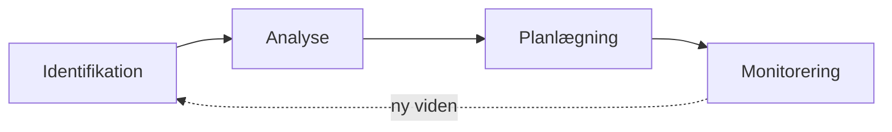

# Risikostyring

Del af [[Agil udvikling]]. Hvordan en projektleder forudser det, der kan gå galt, og handler, før det sker. Kvalitetsrisici behandles også i kvalitetsplanen ([[Kvalitetsstyring#Kvalitetsplanen]]).

## Hvorfor softwareprojekter er svære at lede

*(Sommerville 22)*

Typiske succeskriterier er at levere **til tiden**, holde **budgettet**, levere det, **kunden forventer**, og bevare et **velfungerende team**. Software er sværere at styre end andre ingeniørprojekter, fordi:

1. **Produktet er usynligt.** Man kan ikke se fremdriften og må stole på andres evidens
2. **Store projekter er "one-off".** Erfaring fra tidligere projekter kan ikke altid overføres, og teknologien skifter hurtigt
3. **Processerne er variable og organisationsspecifikke.** Man kan ikke pålideligt forudsige, hvornår en proces giver problemer

Projektlederens fem kerneaktiviteter: **projektplanlægning**, **risikostyring**, **personaleledelse**, **rapportering** og **tilbudsskrivning**.

---

## Tre slags risici efter hvad de rammer

*(Sommerville 22.1)*

> En risiko er *noget, man helst ikke vil have skal ske*. Risikostyring = forudse risici, der kan ramme tidsplan eller kvalitet, og handle for at undgå dem.

| Type | Rammer | Eksempel |
|---|---|---|
| **Projektrisiko** | Tidsplan eller ressourcer | En erfaren arkitekt forlader projektet |
| **Produktrisiko** | Kvalitet eller ydeevne | En indkøbt komponent performer ikke som forventet |
| **Forretningsrisiko** | Organisationen | En konkurrent lancerer et produkt først |

Kategorierne **overlapper**: en erfaren udvikler, der stopper, er projektrisiko (forsinkelse), produktrisiko (afløseren laver flere fejl) og forretningsrisiko (vedkommendes omdømme vandt kontrakter).

Store projekter: resultaterne skrives i et **risk register** med konsekvensanalyse og samles i en **risk management plan**. Små projekter behøver ikke formel dokumentation, men lederen skal kende risiciene.

---

## Risikostyringsprocessen

*(Sommerville 22.1)*

Processen er **iterativ** og kører hele projektet igennem. Ny viden kan ændre en risikos prioritet og dermed planerne.

### 1. Identifikation
Brainstorm i teamet eller erfaring fra tidligere projekter. En **tjekliste** med seks risikotyper er et godt udgangspunkt:

| Risikotype | Eksempel |
|---|---|
| **Estimation** | Udviklingstiden eller systemets størrelse er undervurderet |
| **Organizational** | Omstrukturering giver ny ledelse; finansielle problemer skærer budgettet |
| **People** | Kan ikke rekruttere de rette folk; nøglepersoner er syge på kritiske tidspunkter |
| **Requirements** | Kravændringer kræver stort redesign; kunden forstår ikke konsekvensen af ændringer |
| **Technology** | Databasen klarer ikke det forventede antal transaktioner pr. sekund |
| **Tools** | Værktøjerne kan ikke integreres; genereret kode er ineffektiv |

Den lange liste skal **beskæres**, ellers kan man ikke følge med i dem alle.

### 2. Analyse
Præcise tal er umulige, så hver risiko placeres i **bånd** ud fra erfaring:

| Sandsynlighed | Effekt |
|---|---|
| Insignificant, low, moderate, high, very high | **Catastrophic** (truer projektets overlevelse), **serious** (store forsinkelser), **tolerable** (inden for buffer), **insignificant** |

Tabellen sorteres efter alvor og opdateres i hver iteration. **Tommelfingerregel:** overvej altid alle *katastrofale* risici og alle *alvorlige* med mere end moderat sandsynlighed. Boehm anbefaler en "top 10"; Sommerville mener, antallet afhænger af projektet (5-15).

### 3. Planlægning
Stil **"what-if"-spørgsmål**, også om kombinationer: *hvad hvis flere udviklere er syge samtidig?* *Hvad hvis den eneste ekspert i et open source-bibliotek siger op, og biblioteket ikke performer?*

| Strategi | Virker på | Eksempel |
|---|---|---|
| **Avoidance** (undgåelse) | **Sandsynligheden** | Defekte komponenter → erstat med indkøbte komponenter af kendt kvalitet |
| **Minimization** (minimering) | **Konsekvensen** | Sygdom → organisér teamet med mere overlap, så folk kender hinandens arbejde |
| **Contingency plan** (beredskab) | At være klar til det værste | Budgetnedskæring → briefing til ledelsen om projektets værdi for forretningen |

Rækkefølgen er en prioritering: undgå hvis muligt, ellers minimér, og hav altid en beredskabsplan. Samme tankegang som i kritiske systemer: *avoid, tolerate, recover*.

### 4. Monitorering
Tjek løbende, om antagelserne holder: bliver risikoen mere/mindre sandsynlig, og har konsekvensen ændret sig? Diskutér hver nøglerisiko på **hvert ledelsesmøde**. Hold øje med **indikatorer**:

| Risikotype | Advarselstegn |
|---|---|
| Estimation | Aftalt tidsplan overholdes ikke; rapporterede fejl bliver ikke rettet |
| Organizational | Sladder i organisationen; ledelsen handler ikke |
| People | Dårlig moral, dårlige relationer, høj udskiftning |
| Requirements | Mange change requests; kundeklager |
| Technology | Sen levering af hardware/software; mange teknologiproblemer |
| Tools | Modvilje mod værktøjerne; ønsker om hurtigere computere |

---

## Risikostyring i agil udvikling

*(Sommerville 22.1)*

Samme fire aktiviteter, men **mindre formelt** og ofte ikke dokumenteret.

| Agil **reducerer** | Agil **forstærker** |
|---|---|
| Risiko fra **kravændringer** (korte iterationer, løbende prioritering i [[Product backlog]]) | **Personaleudskiftning**: lidt dokumentation og afhængighed af uformel kommunikation gør det svært at bevare kontinuitet, når nøglepersoner går |

Agile modtræk mod den sidste: kollektivt kodeejerskab og parprogrammering spreder viden, så sprinten ikke dør, fordi én bliver syg ([[XP#Pair Programming]]). Det er en **minimeringsstrategi** i Sommervilles sprog.

---

## Eksamenspunkter

- Forskellen på **projekt-, produkt- og forretningsrisici**, og at de overlapper
- De **fire trin** i processen og at den er **iterativ**
- De **seks risikotyper** i tjeklisten med et eksempel på hver
- **Sandsynlighed × effekt** i bånd, og hvilke risici man altid skal tage alvorligt
- **Avoidance vs. minimization vs. contingency**: virker de på sandsynlighed eller konsekvens?
- Hvorfor agil både **mindsker og øger** visse risici
