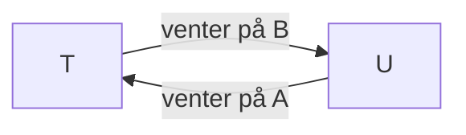
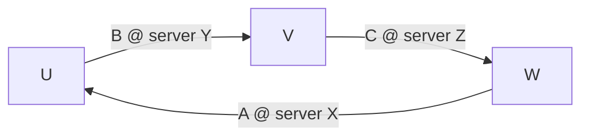

# Concurrency control

Del af [[Distribuerede systemer]]. Tre metoder til at opnå serial equivalence og strict executions fra [[Transaktioner og ACID]], først på én server og så over flere.

> Isolation kunne opnås ved at køre serielt, men **målet er at maksimere concurrency**.

## Sammenligning af de tre metoder

*(Coulouris 16.7)*

| | **Strict 2PL** | **Timestamp ordering** | **Optimistic** |
|---|---|---|---|
| **Type** | Pessimistisk | Pessimistisk | Optimistisk |
| **Konflikt opdages** | Ved hver adgang | Ved hver adgang | Ved **commit** (validering) |
| **Rækkefølgen afgøres** | **Dynamisk** efter adgangsrækkefølge | **Statisk** ved transaktionens **start** | Efter transaktionsnumre ved validering |
| **Ved konflikt** | **Vent** | **Abortér straks** (eller vent) | **Abortér** |
| **Deadlock?** | **Ja**, hovedulempen | Nej | Nej, men **starvation** |
| **Bedst til** | Overvejende updates | Read-only (især multiversion) | Få konflikter |
| **Distribueret** | Låse holdes til udfaldet kendes overalt; **distribuerede deadlocks** | **Globale timestamps** | **Parallel validation** + global ordning |

> **Tre strategier ved en operation: (1) udfør straks, (2) udsæt, (3) abortér.** Strict 2PL bruger (1) og (2) og aborterer kun ved deadlock; **timestamp ordering bruger alle tre**; optimistic lader alt køre og afgør ved validering.

Locking har været brugt i databaser i årtier; CORBA Concurrency Control Service er udelukkende låsebaseret.

---

## Locking

*(Coulouris 16.4)*

**Den metode, de fleste praktiske systemer bruger.** Serveren låser et objekt, før det bruges; er det låst af en anden, **venter** klienten.

### Two-phase locking
En transaktion må **ikke tage nye låse, efter den har frigivet en**: en **growing phase** og en **shrinking phase**.

> **Strict two-phase locking:** alle låse holdes, **indtil transaktionen committer eller aborterer**. Det giver strict executions.

**Granularitet:** den serialiserede del skal være **så lille som muligt**. Låstes hele filialen, kunne kun én bankassistent arbejde ad gangen.

### Read og write locks ("many readers / single writer")

| Sat ↓ / ønsket → | **read** | **write** |
|---|---|---|
| **none** | OK | OK |
| **read** | OK | **wait** |
| **write** | **wait** | **wait** |

- Read locks **deles** (shared locks)
- **Lock promotion** = konvertering til en mere eksklusiv lås. En **delt** read lock kan ikke promoveres; transaktionen må vente. **Demotion er aldrig sikkert** før commit
- *Lost updates* forhindres ved read lock ved læsning og **promotion** til write lock; *inconsistent retrievals* forhindres, fordi read locks forsinker opdateringen

### Reglerne for strict 2PL
1. Når en operation tilgår et objekt:
   - (a) ikke låst → lås og fortsæt
   - (b) **konfliktende** lås hos en anden → **vent**
   - (c) **ikke-konfliktende** lås hos en anden → **del** låsen
   - (d) allerede låst af samme transaktion → **promovér** om nødvendigt
2. Ved commit/abort **låses alt op**

Klienten har **ingen adgang** til lock/unlock; det sker automatisk. En **lock manager** har en `Lock` pr. objekt med `synchronized` metoder (`acquire` bruger `wait()` i en løkke, `release` kalder `notifyAll()`).

### Deadlocks
> **Deadlock** = hvert medlem af en gruppe transaktioner venter på, at et andet medlem frigiver en lås.

T har write lock på A og vil have B; U har B og vil have A. I en **wait-for graph** (knuder = transaktioner, kanter = "venter på"):

> **Deadlock hvis og kun hvis der er en cyklus.** Aborteres én transaktion i cyklen, brydes den.

| Metode | Hvordan | Problem |
|---|---|---|
| **Prevention** | Lås alt ved start, eller i **fast rækkefølge** | Begrænser unødigt; man kan sjældent forudsige objekterne |
| **Detection** | Find **cykler** i wait-for grafen | Valg af offer (alder, antal cykler) |
| **Timeouts** | En lås er **invulnerable** i en periode, derefter **vulnerable**: venter nogen, brydes den | **Aborterer uden deadlock**, straffer lange transaktioner |

> **Timeouts er mest brugt i praksis, men detection er pænere:** der aborteres kun ved faktisk deadlock, og offeret kan vælges.

**CORBA's upgrade lock** forebygger den typiske deadlock, hvor to transaktioner tager read locks og vil promovere: en upgrade lock tillader læsning, men konflikter med andre upgrade locks.

Deadlock er det samme begreb som i OS-faget; Token Ring kan fx deadlocke på et tabt token ([[Link layer]]).

### At øge concurrency

| Teknik | Idé | Pris |
|---|---|---|
| **Two-version locking** | Én skriver tentative versioner, mens andre læser de committede. **Read / write / commit locks** | Reads kan forsinke andres commit; deadlock blandt ventende committere |
| **Hierarchic locks** (Gray) | Låse på flere granulariteter (Branch → Account). Før et barn låses, sættes en **intention-lås** (I-read/I-write) på forfædrene | Mere komplekse kompatibilitetstabeller |

---

## Optimistic concurrency control

*(Coulouris 16.5)*

**Motivation:** locking har overhead selv for read-only-transaktioner, giver deadlocks, og låse kan ikke frigives før slut. **Observationen** (Kung & Robinson): sandsynligheden for, at to transaktioner rammer samme objekt, er lav.

| Fase | Indhold |
|---|---|
| **Working** | Arbejd på **tentative versioner** af committede værdier. Før **read set** og **write set**. **Dirty reads er umulige** |
| **Validation** | Ved `closeTransaction` tjekkes for konflikter; fejler det, aborteres |
| **Update** | Ændringerne gøres permanente |

**Transaktionsnumre** tildeles **ved starten af validation** og definerer den serielle rækkefølge.

| Tv | Ti | Regel |
|---|---|---|
| `write` | `read` | **1.** Ti må ikke læse objekter skrevet af Tv |
| `read` | `write` | **2.** Tv må ikke læse objekter skrevet af Ti |
| `write` | `write` | **3.** De må ikke skrive hinandens objekter |

Lad kun **én transaktion ad gangen** være i validation+update; så er **regel 3 automatisk opfyldt**, og udførelsen er strict.

| | **Backward validation** | **Forward validation** |
|---|---|---|
| **Sammenligner** | Tv's **read set** mod write sets for **tidligere** overlappende transaktioner | Tv's **write set** mod read sets for **aktive** transaktioner |
| **Ved konflikt** | Kun: abortér den validerende | **Fleksibel**: udsæt, abortér de andre, eller abortér sig selv |
| **Ulempe** | Skal **gemme gamle write sets** | Nye transaktioner kan starte under valideringen |

Read sets er større end write sets. **Read-only-transaktioner består altid forward validation.**

> **Starvation:** en transaktion kan aborteres igen og igen. Modtræk: giv den eksklusiv adgang.

---

## Timestamp ordering

*(Coulouris 16.6)*

Hver transaktion får et **unikt timestamp ved start**, og hver operation valideres, **når den udføres**.

> **Grundreglen:** et `write` er kun gyldigt, hvis objektet **sidst blev læst og skrevet af tidligere transaktioner**. Et `read` er kun gyldigt, hvis objektet **sidst blev skrevet af en tidligere transaktion**.

**Kan ikke give deadlock**, fordi transaktioner kun venter på **tidligere** transaktioner. Hvert objekt har et **write timestamp** (committed version), **tentative versioner** og et **maks. read timestamp**.

| # | Tc | Ti | Krav |
|---|---|---|---|
| **1** | `write` | `read` | Tc ≥ objektets maks. read timestamp |
| **2** | `write` | `write` | Tc > write timestamp på committed version |
| **3** | `read` | `write` | Tc > write timestamp på committed version |

- **Write:** opfyldt → skriv tentative version; ellers **abortér** (for sent)
- **Read:** vælg versionen med største write timestamp ≤ Tc. **Committed** → læs. **Tentative** → **vent** (forhindrer dirty reads). Ingen → **abortér**

> Commit lykkes altid, men committede versioner skal oprettes i **timestamp-rækkefølge**. **Timestamp ordering er strict.** "Ignore obsolete write": et for sent write kan ignoreres, hvis ingen har læst objektet.

**Multiversion timestamp ordering** (Reed): gem **gamle committede versioner**. **Reads afvises aldrig** (de læser en gammel version), regel 2 forsvinder (hver transaktion skriver sin egen version), og kun regel 1 er tilbage. Pris: lagerplads.

---

## Concurrency control over flere servere

*(Coulouris 17.4)*

Concurrency control er **modulært**: hver server passer sine egne objekter. Men serverne er **i fællesskab ansvarlige** for global serial equivalence:

> Er T før U i deres konfliktende adgang på **én** server, skal de være i **samme rækkefølge på alle servere**.

### Locking
Låse må **ikke frigives, før udfaldet kendes på alle servere**, så objekter er låst under hele [[Distribuerede transaktioner og 2PC|commit-protokollen]]. Lock managers låser **uafhængigt** og kan pålægge forskellige ordninger:

| T | U |
|---|---|
| `write(A)` at X, låser A | |
| | `write(B)` at Y, låser B |
| `read(B)` at Y, **venter på U** | |
| | `read(A)` at X, **venter på T** |

**T før U på X, U før T på Y** → distribueret deadlock.

### Timestamp ordering
**Globalt unikke timestamps** `<local timestamp, server-id>` (server-id mindst betydende), udstedt af den første coordinator. Virker **selv med usynkroniserede ure**, men af effektivitetshensyn bør de være nogenlunde synkroniserede. Konflikter løses løbende, så en participant siger kun **No** ved commit, hvis den er **crashet**.

### Optimistic
1. **Commitment deadlock:** reglen om én transaktion ad gangen i validering antager, at validering er hurtig, men 2PC tager tid. Løsning: **parallel validation**, hvor **regel 3** også skal tjekkes
2. **Inkonsistente ordninger:** uafhængige servere kan serialisere i forskellig rækkefølge. Løsning: **global validation** (tjek for cykler) eller et **globalt transaktionsnummer** fra 2PC-coordinatoren

---

## Distribuerede deadlocks

*(Coulouris 17.5)*

> Der kan være en **cyklus i den globale wait-for graph, som ikke findes i nogen lokal**.

Hver server ser kun **én kant**.

**Centraliseret detektion** (én server samler graferne) er **dårligt**: dårlig tilgængelighed, ingen fejltolerance, ingen skalerbarhed, og dyrt. Sjældnere indsamling giver langsommere detektion.

**Phantom deadlocks:** en "detekteret" deadlock, der ikke findes, fordi en lås er frigivet undervejs. Med **two-phase locks** kan det kun ske, hvis en transaktion i cyklen **aborterer** under detektionen.

### Edge chasing (path pushing)
Den **decentrale** tilgang: den globale graf konstrueres ikke; serverne sender **probes** langs kanterne.

| Trin | Indhold |
|---|---|
| **Initiation** | T begynder at vente på U, og U venter på et objekt et andet sted → send probe **`<T → U>`** |
| **Detection** | Venter U også, tilføjes den, U venter på (`<T → U → V>`). **Tjek for cyklus** før videresendelse |
| **Resolution** | Abortér en transaktion i cyklen |

Probes går via **coordinatorerne**, så hver koster to beskeder: **2(N − 1)** for en cyklus med N transaktioner. De fleste deadlocks involverer kun to.

**Prioriteter:** flere servere kan opdage samme cyklus og abortere hver sin. Løsning: totalordn med prioriteter (fx timestamps) og **abortér altid den laveste**. Sendes probes kun "downhill" for at spare beskeder, kan deadlocks gå **udetekterede**; **probe queues** løser det, men er komplekse.

---

## Hvor modellen ikke slår til
Klassisk isolation passer dårligt til moderne dokumentdeling, så mange systemer bruger **optimistisk concurrency control + conflict resolution**:

| System | Fremgangsmåde |
|---|---|
| **Dropbox** | Hele filer; første write vinder. Versionshistorik |
| **Google Docs** | Samtidig redigering på tegn-/celleniveau; regneark: **last update wins** |
| **Wikipedia** | Første write accepteres; næste får en **edit conflict** |
| **Dynamo** (Amazon) | Kun `get`/`put`, **ingen isolation**, svagere konsistens for tilgængelighedens skyld. Versioner forliges af applikationen eller "last write wins" (samme afvejning som [[DNS]]) |
