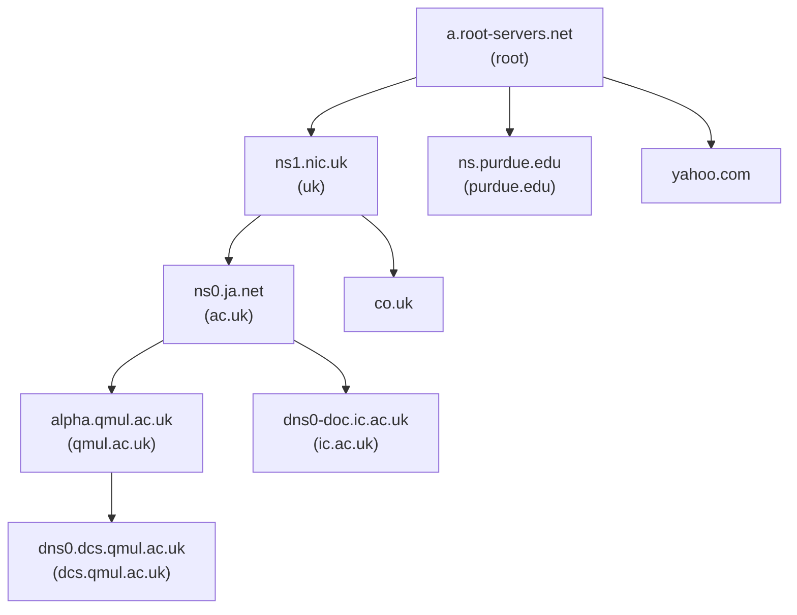

# DNS

Del af [[Distribuerede systemer]]. Den konkrete udgave af begreberne i [[Navne og navneopløsning]]. I netværksstakken er DNS en applikationslagsprotokol, der afbilder hostnavne til de IP-adresser, transport- og netværkslaget bruger *(Deitel 16.7.1)*.

## Baggrund

*(Coulouris 13.2.3)*
Designet af **Mockapetris** (RFC 1034/1035). DNS erstattede **én central masterfil** med alle hostnavne, hentet med FTP, som havde tre mangler: den **skalerede ikke**, organisationer ville **administrere deres egne** navne, og der var brug for en **generel** navnetjeneste.

DNS navngiver primært **computere** (med IP-adresser som attributter), men kan i princippet navngive alt. Det, der generelt kaldes *naming domains*, hedder **domains**.

> Enhver klient kan resolve ethvert navn takket være **hierarkisk partitionering**, **replikering** og **caching**.

## Domænenavne
Internettets name space er opdelt organisatorisk og geografisk, med det øverste domæne **til højre**.

| Generisk TLD | Anvendelse |
|---|---|
| `com` / `edu` / `gov` / `mil` | Kommercielle / uddannelse / amerikanske myndigheder / militær |
| `net` / `org` / `int` | Netværkscentre / øvrige organisationer / internationale |

Landedomæner (`uk`, `fr` …) har ofte egne underdomæner (`co.uk`, `ac.uk`). **Geografiske navne er rene konventioner**: `doit.co.uk` kan pege på et kontor i Spanien.

## Query-typer

| Type | Beskrivelse |
|---|---|
| **Host name resolution** | Hostnavn → IP-adresse (det mest almindelige) |
| **Mail host location** | Domæne → **liste af mailhosts med præference**, så der kan prøves alternativer |
| **Reverse resolution** | IP → domænenavn, via domænet `in-addr.arpa`. Kun for egne adresser |
| **Host information** | Arkitektur og OS. Frarådes, fordi det hjælper angribere |

En query angiver **domænenavn, class** (`IN`) og **type**.

## Name servers

### Zones
Data er opdelt i **zones**. En zone indeholder:
1. Attributdata for navnene i et domæne, **minus** delegerede underdomæner
2. Navne og adresser på **mindst to** servere med **authoritative** data for zonen
3. Navne på servere for delegerede underdomæner + **glue**-data (deres IP-adresser)
4. Zone-management-parametre

### Primary, secondary og caching

| Servertype | Rolle |
|---|---|
| **Primary (master)** | Læser zonedata fra den lokale **master file** |
| **Secondary** | Henter zonedata fra primary og tjekker typisk 1–2 gange dagligt, om den er opdateret |
| **Caching-only** (BIND) | Gemmer kun det, den lærer ved at resolve for klienter |

Primary og secondary er **authoritative**. Andre servere må **cache**, men skal markere svaret **non-authoritative**. Hver indgang har en **time-to-live (TTL)**: data, der sjældent ændres, får **lang TTL**; data, der snart ændres, får **kort TTL**.

### Serverhierarkiet



- **Root servers** har indgange for **flere niveauer** for at spare navigationsskridt. De er authoritative for de generiske TLD'er, men **ikke** for landedomænerne
- Alle servere kender en eller flere root servers og typisk en server for **parent-domænet**
- `www.berkeley.edu` kan i værste fald resolves i **to navigationsskridt**
- *Eksempel:* `dns0.dcs.qmul.ac.uk` har en **cachet** indgang for `ic.ac.uk` og kan derfor gå direkte til `dns0-doc.ic.ac.uk`

## Navigation
- Klienten hedder en **resolver** (typisk biblioteks-software) og bruger **request-reply over UDP**, port **53** ([[Transport layer]])
- Resolveren **timer ud og gensender** og kan have en prioriteret liste af servere
- DNS understøtter **iterativ og rekursiv** navigation, men servere er **ikke forpligtet** til rekursiv, fordi den binder servertråde
- Flere queries kan pakkes i én request

## Resource records

| Type | Betydning | Indhold |
|---|---|---|
| **A** / **AAAA** | Adresse (IPv4 / IPv6) | IP-nummer |
| **NS** | Authoritative name server | Serverens domænenavn |
| **CNAME** | Kanonisk navn for et alias | Domænenavn |
| **SOA** | Start på en zones data | Zoneparametre |
| **PTR** | Reverse lookup | Domænenavn |
| **HINFO** | Host information | Arkitektur og OS |
| **MX** | Mail exchange | `<preference, host>`-par |
| **TXT** | Tekst | Vilkårlig tekst |

```
; Del af databasen for dcs.qmul.ac.uk
domain name       TTL  class  type   value
dcs.qmul.ac.uk    1D   IN     NS     dns0
dcs.qmul.ac.uk    1D   IN     NS     dns1
dcs.qmul.ac.uk    1D   IN     MX     1 mail1.qmul.ac.uk
dcs.qmul.ac.uk    1D   IN     MX     2 mail2.qmul.ac.uk
www               1D   IN     CNAME  traffic
traffic           1D   IN     A      138.37.95.150
```

**Delegering** af et underdomæne (i `qmul.ac.uk`'s database): NS-records **plus glue A-records**:
```
dcs        1D  IN  NS  dns0.dcs
dns0.dcs   1D  IN  A   138.37.88.249
```

**Load sharing:** flere computere med samme navn; serveren returnerer adresserne **round-robin**. Caching kan ødelægge det, så de records får **kort TTL**.

## BIND
UNIX-implementeringen: klienter linker **resolver-biblioteket** ind, servere kører dæmonen **`named`**. Typisk opsætning: én primary, en eller flere secondaries på forskellige LAN, og ofte en caching-only server på hver computer.

## Vurdering

**Styrker:** korte svartider trods enorm skala, fordi navngivne objekter **ændres sjældent** (et "clement environment" for caching og replikering).

**Svagheder:**
- **DNS tillader inkonsistens**: forældede data i op til **dage**. Det betyder dog intet, før en klient faktisk bruger dem
- DNS forholder sig ikke til, hvordan forældede adresser **opdages**
- Antager **én mailservice pr. domæne**
- Gemmer kun "**den laveste fællesnævner**" af data og sameksisterer med lokale tjenester (NIS, Active Directory)
- **Stiv** over for ændringer i name space-strukturen. Det adresserer [[Directory services, X.500 og GNS#Global Name Service (GNS)|GNS]]

DNS er også et angrebsmål: ændres adressen bag et navn, sendes brugere til et falsk site ([[Trusler og angreb]]). DNS er en klassisk **klient-server**-arkitektur med hierarkisk partitionering, og det, der gør URL'er **location-transparente** ([[Udfordringer i distribuerede systemer]]).
