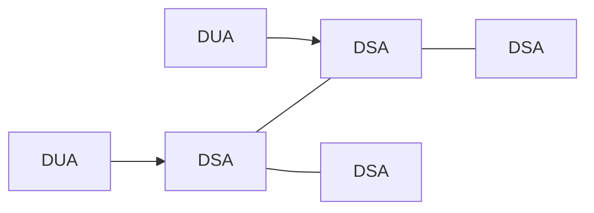
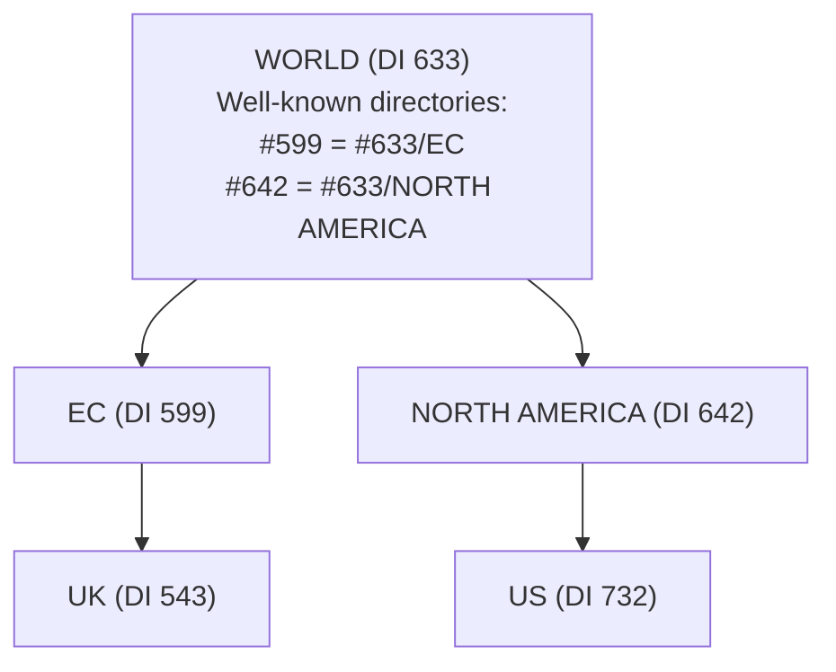
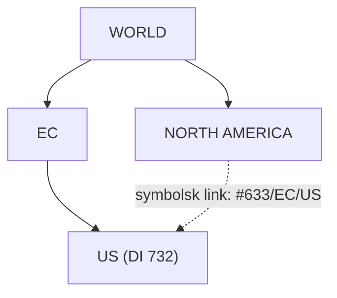

# Directory services, X.500 og GNS

Del af [[Distribuerede systemer]]. Bygger på [[Navne og navneopløsning]].

## Directory services

*(Coulouris 13.3)*

Navnetjenester slår **attributter op ud fra et navn**. Det **duale** er at slå op **ud fra attributter**, så navnet blot er endnu en attribut. Brugere kender nogle gange kun egenskaber: *"hvem har telefonnummer 020-555 9980?"*, *"hvor kan jeg printe i farver?"*

> En **directory service** gemmer bindinger mellem navne og attributter og **slår indgange op, der matcher attributbaserede specifikationer**.

| Betegnelse | Svarer til |
|---|---|
| **Yellow pages** / attribute-based name services | Directory services |
| **White pages** | Almindelige navnetjenester |

Resultatet er attributterne for alle matchende objekter (eller en delmængde). Eksempler: **Active Directory**, **X.500**, **LDAP**. **UDDI** giver både white og yellow pages om web services.

**Discovery services** er directory services for **spontane netværk**. En almindelig directory service har en velkendt adresse; en discovery service må findes med **multicast** første gang.

| Fordele ved attributter | Fordel ved navne |
|---|---|
| Mere kraftfulde: vælg objekter ud fra præcise specifikationer. **Afslører ikke organisationens struktur** | **Simplere at bruge** |

---

## X.500

*(Coulouris 13.5)*

En directory service, der primært bruges til **beskrivende forespørgsler**: white pages, yellow pages, personlige detaljer og processer, der søger services. Defineret af **ITU og ISO** som en OSI-service, men designet er et generelt design for directory services og basis for **LDAP**.

| Begreb | Betydning |
|---|---|
| **DIT** (Directory Information Tree) | Navnetræet |
| **DIB** (Directory Information Base) | Hele strukturen **inklusive data**. Tanken var én global DIB fordelt på organisationers servere |
| **DSA** (Directory Service Agent) | Server |
| **DUA** (Directory User Agent) | Klient |

En DUA kan kontakte **enhver** DSA. Har den ikke data, **kalder den andre DSA'er** (server-styret navigation) eller **omdirigerer** klienten.



### Navne og attributter
- Hver DIB-indgang = et **navn** + en mængde **attributter**. Navnet er **stien fra roden**; en DUA kan bruge en **base node** og relative navne
- En attribut har en **type** (`commonName`, `telephoneNumber`, `mail` …) og **en eller flere værdier**. Typer defineres i **ASN.1**
- Indgange har **object classes** (`organization`, `organizationalPerson`) i et **arvehierarki**, der bestemmer obligatoriske og valgfrie attributter
- **Distinguished Name (DN):** de attributter, der vælges til at bestemme indgangens position. Samme begreb bruges i X.509-certifikater ([[Certifikater og PKI]])

```
X.500 Service (root)
└── Great Britain (country)
    └── University of Gormenghast (organization)
        └── Department of Computer Science (organizationalUnit)
            └── Departmental Staff (organizationalUnit)
                └── Alice Flintstone (person)
```

```
commonName       Alice.L.Flintstone / Alice Flintstone / A. Flintstone
surname          Flintstone
telephoneNumber  +44 986 33 4604
mail             alf@dcs.gormenghast.ac.uk
roomNumber       Z42
```

### Operationer

| Operation | Beskrivelse |
|---|---|
| **read** | Absolut eller relativt navn + ønskede attributter. DSA'en **navigerer i DIT'et** |
| **search** | **Attributbaseret**: et **base name** og et **filterudtryk**, der evalueres for hver node under base. Returnerer navnene, hvor filteret er sandt |

*Eksempel:* find `commonName` på medarbejdere i lokale **Z42**; en efterfølgende **read** henter alle attributter. (LDAP-syntaks, ikke fra bogen: filter `(roomNumber=Z42)`.)

> **Search kan være dyr**, så scope, tid og resultatstørrelse kan begrænses.

DIB'en er **partitioneret** og **replikeret**; over et WAN kræves omfattende caching. I **QUIPU** kan værdier være inkonsistente i **flere minutter**, hvilket anses for acceptabelt. Adgangskontrol gælder både forespørgsler og opdateringer.

### LDAP
X.500 blev ikke en succes: organisationer ville ikke lægge data i **offentlige directories**, og kompleksiteten var for stor. **LDAP** (University of Michigan, RFC 2251):

| Egenskab | Forklaring |
|---|---|
| **Transport** | Direkte over **TCP/IP** i stedet for ISO-stakken |
| **Simplere API** og **tekstuel encoding** | I stedet for ASN.1 |
| **Uafhængig af X.500** | Enhver LDAP-kompatibel server kan bruges, fx Active Directory |
| **Sikkerhed** | Autentificeret adgang |

> LDAP er **bredt udbredt**, især til intranet-directories.

---

## Global Name Service (GNS)

*(Coulouris 13.4)*

Designet af **Lampson** m.fl. hos DEC (1986) til resource location, mail addressing og authentication, efter de fem krav i [[Navne og navneopløsning#De fem krav (eksamensrelevante)|Navne og navneopløsning]]. **Fokus: at håndtere ændringer** i en database med lang levetid, fx navneskift og **opkøb af firmaer**.

**Konsistens:** GNS antager, at **opdateringer er sjældne**, og at **langsom spredning er acceptabel**, fordi klienter kan opdage og komme sig over forældede data.

### Struktur
- Et **træ af directories**, hver med et unikt **directory identifier (DI)**
- Bladene er **value trees**, så attributter kan være strukturerede
- Navne har to dele: `<directory name, value name>`, fx `<EC/UK/AC/QMUL, Peter.Smith/mailboxes>`
- Træet er **partitioneret** og **replikeret**. Samtidige opdateringer af samme navn: kun én må lykkes. Replikaer opdateres asynkront med **eventual consistency**

### Sammenfletning under en ny rod
Databaserne med rødderne **EC** og **NORTH AMERICA** flettes under en ny rod **WORLD**.



**Problemet:** klienter bruger stadig `</UK/AC/QMUL, Peter.Smith>`, hvis rod er EC (**working root**), ikke WORLD.

**Løsningen:** working root er en del af programmets miljø. Klientens user agent sætter EC's DI foran: `<#599/UK/AC/QMUL, Peter.Smith>`. Serveren finder `#599` via en **tabel af well-known directories** i den aktuelle rod, og alle servere informeres, når roden ændres.

### Omstrukturering
Flyttes US under EC, indsættes et **symbolsk link** (`US → #633/EC/US`) på den gamle plads, så gamle navne omdirigeres. Det svarer til et **alias**.



### Vurdering
GNS (efterkommer af Xerox' **Grapevine** og **Clearinghouse**) løser **skalerbarhed og rekonfigurerbarhed**, det DNS er stiv over for. **Men** tabellen af well-known directories skal **replikeres på hver node** og kan blive meget stor, hvilket **er i konflikt med skalerbarhedsmålet**.
