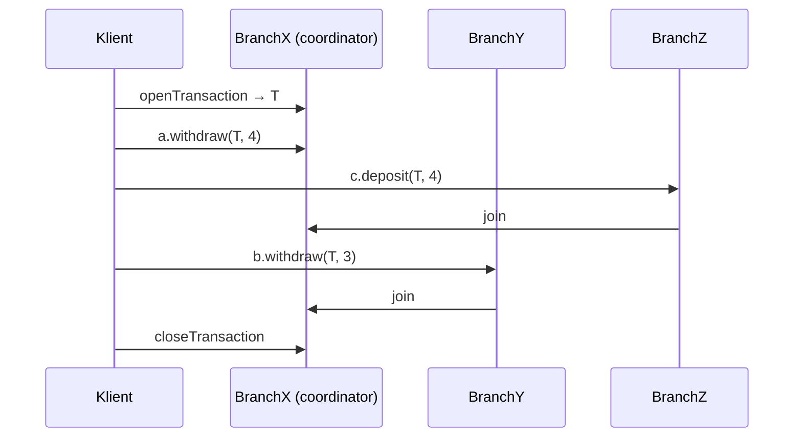
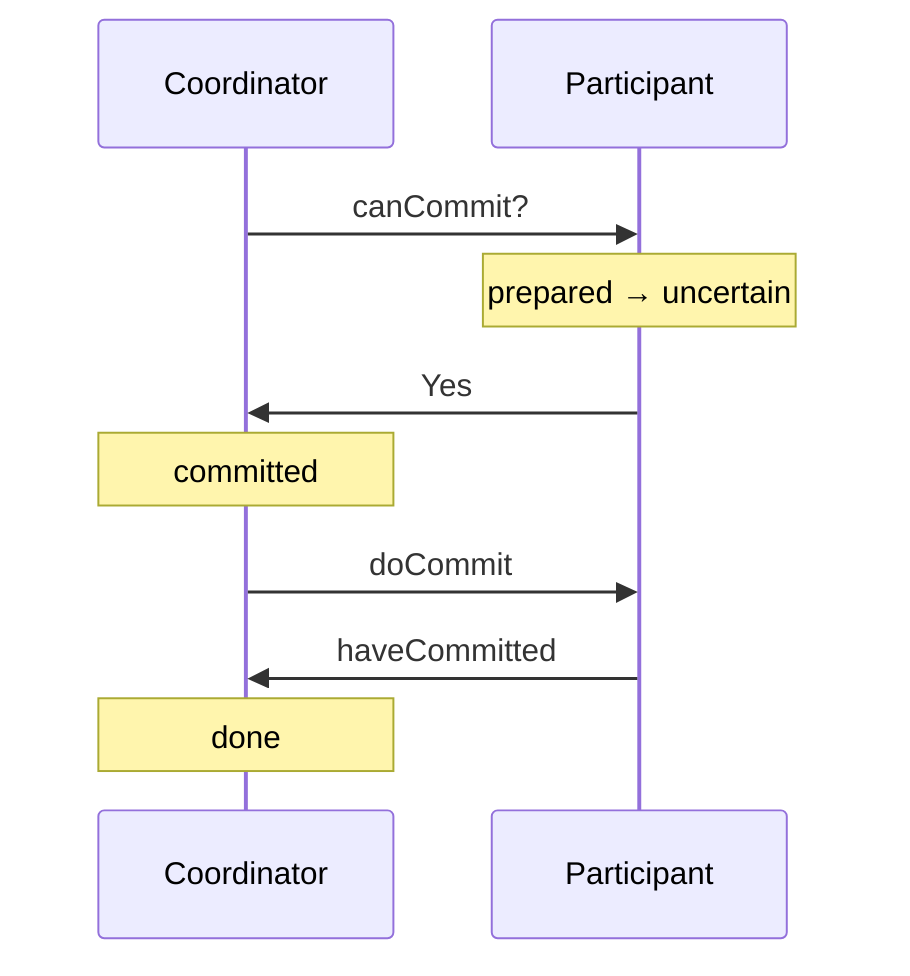

# Distribuerede transaktioner og 2PC

Del af [[Distribuerede systemer]]. Bygger på [[Transaktioner og ACID]].

> En **distribueret transaktion** tilgår objekter på **flere servere** *(Coulouris 17.1)*.

| Problem | Løsning |
|---|---|
| **Atomicity på tværs**: alle committer eller alle aborterer | En **coordinator** + **two-phase commit** |
| **Global serialisering** | Afhænger af metoden; kan give distribuerede deadlocks → [[Concurrency control#Concurrency control over flere servere]] |
| **Recovery** | En **recovery manager** med en recovery file |

## Flat vs. nested

| | **Flat** | **Nested** |
|---|---|---|
| Struktur | Requests fra ét niveau | Subtransaktioner i vilkårlig dybde |
| Udførelse | **Sekventielt**: hver request fuldføres før den næste | Søskende kan køre **parallelt** på forskellige servere |

*Eksempel:* overfør $10 fra A til C og $20 fra B til D på servere X, Y, Z. Som fire nestede subtransaktioner kan de fire requests køre parallelt.

## Coordinator og participants

| Rolle | Ansvar |
|---|---|
| **Coordinator** | Den, der udførte `openTransaction`. Styrer **commit eller abort** og fører en **liste af participants** |
| **Participant** | Hver server med objekter i transaktionen. Holder styr på sine recoverable objects og **kender coordinatoren** |

**`join(Trans, participant)`**: første gang et objekt på en server bruges i T, joiner serverens participant coordinatoren. At de kender hinanden, er det, der gør commit muligt.

**Globalt unikke TID'er:** `<server-id, nummer unikt på serveren>`. For nested transactions er et sub-TID en **udvidelse** af forælderens. (Samme konstruktion som globale timestamps.)

---

## Two-phase commit

*(Coulouris 17.3)*

2PC (Gray 1978) er den mest anvendte atomic commit protocol.

**Hvorfor ikke one-phase commit?** Coordinatoren kan ikke bare gentage "commit", for en server kan have brug for at **abortere ensidigt**: en deadlock-løsning, en fejlet optimistisk validering eller et crash.

> **Prepared state:** når en participant har stemt Yes, **må den ikke abortere**. Den skal først gemme **alle ændrede objekter + status `prepared` i permanent storage**, så den kan committe, selv hvis den crasher.

| Operation | Retning |
|---|---|
| `canCommit?(trans) → Yes/No` | coordinator → participant |
| `doCommit(trans)` / `doAbort(trans)` | coordinator → participant |
| `haveCommitted(trans, participant)` | participant → coordinator |
| `getDecision(trans) → Yes/No` | participant → coordinator (har stemt Yes, intet svar) |

**Fase 1 (voting):**
1. Coordinatoren sender **`canCommit?`** til alle
2. Participanten **prepares** og svarer Yes, eller svarer No og **aborterer straks**

**Fase 2 (completion):**
3. **Alle Yes** (inkl. coordinatorens egen) → **commit**, send `doCommit`. Ellers → **abort**, send `doAbort` til dem, der stemte Yes
4. Participants handler og kalder `haveCommitted`

Efter step 3 er transaktionen reelt afgjort; step 4 fortæller bare coordinatoren, hvornår den kan rydde op.

### Timeouts

| Hvem venter | Handling |
|---|---|
| **Participant i `uncertain`** (stemt Yes) | Kan **ikke beslutte selv**, og objekterne forbliver låst. Sender `getDecision`. **Er coordinatoren nede, må den vente, til den er erstattet**: protokollens værste problem |
| **Participant uden `canCommit?`** | Har ikke stemt → **kan abortere** |
| **Coordinator, der venter på stemmer** | Kan beslutte **abort**; sene Yes ignoreres |

Kooperative varianter lader participants spørge hinanden, men er alle uncertain, hjælper det ikke. **Three-phase commit** indskyder en `preCommit`-runde, men koster flere beskeder i det normale tilfælde.

### Performance og konsensus
Fejlfrit med N participants: ca. **3N beskeder** og **tre runder** (`haveCommitted` tælles ikke). 2PC fuldfører altid til sidst, men **uden tidsgrænse**.

> **2PC er en konsensusprotokol.** Konsensus kan ikke opnås i et asynkront system med procesfejl, men 2PC gør det alligevel, fordi **crash failures maskeres**: en crashet proces erstattes og genskaber sin tilstand fra permanent storage ([[Fundamentale modeller#Masking]]).

### 2PC for nested transactions
> **Provisional commit ≠ prepared.** Provisional commit betyder kun, at subtransaktionen afsluttede korrekt; intet er i permanent storage.

Ekstra operationer: `openSubTransaction(trans)` og `getStatus(trans)`. Et barn, der provisionally committer, rapporterer sin og efterkommernes status; et barn, der aborterer, rapporterer kun abort. **Orphans** (subtransaktioner med en aborteret forfader) spørger selv med `getStatus` efter en timeout.

Top-level er coordinator; participants er alle provisionally committede subtransaktioner uden aborterede forfædre.

| | **Hierarchic** | **Flat** |
|---|---|---|
| Hvordan | `canCommit?` sendes **ned ad træet** | `canCommit?(trans, abortList)` sendes **direkte til alle** |
| Fordel | Hver ser kun på sin forælders subtransaktioner | Direkte kommunikation |
| Ulempe | Beskeder i etaper | Kræver **abort-listen**, fordi to subtransaktioner kan dele server |

---

## Transaction recovery

*(Coulouris 17.6)*

Atomicity kræver **alle effekter af committede og ingen af aborterede** transaktioner: **durability** + **failure atomicity**. Begge håndteres af **recovery manageren**, som gemmer committede objekter i en **recovery file**, genskaber dem efter crash, reorganiserer filen og frigiver plads. Mod media failures bruges **stable storage**.

### Intentions list
Pr. aktiv transaktion: **referencer til og værdier af alle objekter, den ændrer**. Ved commit erstattes de committede versioner; ved abort slettes de tentative.

> **Ved 2PC:** når en participant siger prepared, skal **intentions listen og objekterne allerede ligge i recovery-filen**.

| Entry-type | Indhold |
|---|---|
| **Object** | En objektværdi |
| **Transaction status** | TID + `prepared` / `committed` / `aborted` (+ 2PC-status) |
| **Intentions list** | TID + `<objectID, position i filen>` |

### Logging
Recovery-filen er en **log**: et snapshot efterfulgt af historikken.
- Ved **prepare** appendes objekterne, derefter `prepared` med intentions listen
- `append` er atomar, og **sekventielle skrivninger er hurtige**
- **Efter crash aborteres alt uden `committed`**, så `committed` skal være et **forced write**
- Status-entries har **baglæns-pointere**

**Recovery baglæns:** følg pointerne og genskab objekter fra committede transaktioner; hvert objekt genskabes **kun én gang**. Fundne `prepared`-transaktioner markeres `aborted`. **Recovery skal være idempotent**, fordi serveren kan crashe igen.

**Checkpointing:** skriv de aktuelle committede værdier til en **ny** recovery-fil sammen med entries for uafklarede transaktioner. Giver kortere recovery og frigiver plads.

### Shadow versions
Et **map** knytter objekt-id'er til positioner i en **version store**. Ved prepare appendes **shadow versions**; ved commit erstattes mappet atomart af et nyt (derfor i stable storage).

| | **Shadow versions** | **Logging** |
|---|---|---|
| **Recovery** | Hurtigere | Langsommere |
| **Normal drift** | Langsommere (ekstra stable storage-skrivning) | Hurtigere (kun appends) |

Ved distribuerede transaktioner skal status og intentions lists ligge i en separat **transaction status file**, og recovery må tjekke, om mappet nåede at blive opdateret.

### Recovery af 2PC

| Ny status | Betydning |
|---|---|
| **`done`** | Coordinatoren: 2PC er fuldført |
| **`uncertain`** | Participanten: har stemt Yes, kender ikke udfaldet |

Coordinatoren skriver en **coordinator-entry** (participant-listen) i fase 1 og `committed`/`aborted` som forced write i fase 2. Participanten skriver en **participant-entry** + `uncertain` som forced write, når den stemmer Yes.

| Rolle | Seneste status | Handling ved genstart |
|---|---|---|
| Coordinator | `prepared` / `aborted` | Ingen beslutning → send abort til alle |
| Coordinator | `committed` | Send `doCommit` igen |
| Coordinator | `done` | Intet |
| Participant | `committed` | Send `haveCommitted` |
| Participant | `uncertain` | Send `getDecision` |
| Participant | `prepared` | Har ikke stemt → kan abortere |

Ved checkpointing skal coordinator-entries uden `done` og participant-entries med `uncertain` beholdes.

**Nested transactions:** objektet får en **stack af tentative versioner**, én pr. subtransaktion. Provisional commit popper egen og forælderens version og pusher sin egen; abort popper; top-level commit gør toppen til den committede version.

> **Kapitlets pointe:** selvom servere crasher i et asynkront system, kan de nå **konsensus** om udfaldet, fordi crashede servere erstattes af processer, der genskaber tilstanden fra permanent storage. Transaktionsapplikationer kræver lang datalevetid og integritet, men sjældent øjeblikkelig respons, og brugerne må leve med forsinkelse under recovery.
