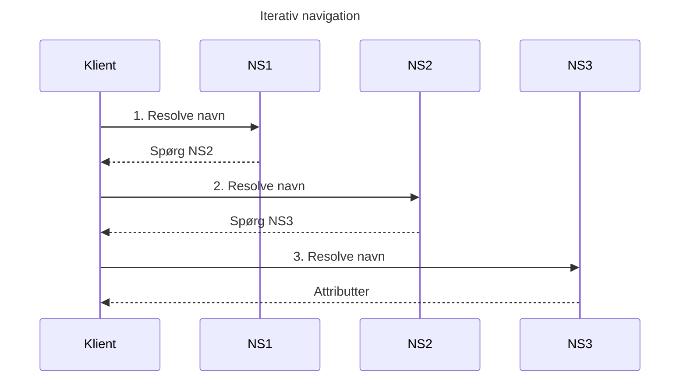
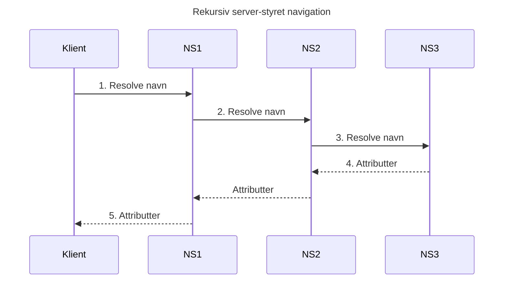

# Navne og navneopløsning

Del af [[Distribuerede systemer]]. Konkrete navnetjenester: [[DNS]] og [[Directory services, X.500 og GNS]].

## Hvorfor navngivning er fundamentalt

*(Coulouris 13.1)*

Navne bruges om computere, services, remote objects, filer og brugere. **Processer kan ikke dele ressourcer, medmindre de kan navngive dem konsistent**, og brugere kan ikke kommunikere uden at kunne navngive hinanden.

| Service | Slår op på | Leverer |
|---|---|---|
| **Name service** | **Navn** | Data om navngivne objekter ("white pages") |
| **Directory service** | **Attributter** / beskrivelse | Objekter, der matcher ("yellow pages"), se [[Directory services, X.500 og GNS]] |

## Navne, adresser og attributter

| Begreb | Definition |
|---|---|
| **Menneskelæseligt navn** | Til mennesker: `/etc/passwd`, `www.cdk5.net` |
| **Identifier** | Fortolkes **kun af programmer**, valgt for effektivt opslag: remote object references, NFS file handles |
| **Pure name** | Et **ufortolket bitmønster**, der **altid skal slås op** (Needham) |
| **Non-pure name** | Indeholder information om objektet, fx placering |
| **Adresse** | Identificerer objektets **placering**. Effektiv, men **utilstrækkelig som identifikation**, fordi objekter flytter. E-mailadresser ændres, når man skifter arbejde |
| **Resolve** | Oversæt et navn til data om ressourcen |
| **Binding** | Associationen mellem et navn og et objekt |
| **Attribut** | Værdien af en egenskab ved objektet |

> Navne bindes til **attributter**, ikke til selve objektet. En central attribut er ofte **adressen**. DNS mapper et domænenavn til IP-adresse, type og gyldighedstid; X.500 mapper en person til e-mail og telefon; CORBA Naming Service mapper til en remote object reference.

**Adresser er også navne**, der skal slås op. En URL resolves gennem flere lag:

```
http://www.cdk5.net:8888/WebExamples/earth.html
        │ DNS            │ socket   │ webserverens filsystem
        ▼                ▼          ▼
     55.55.55.55   +  port 8888 + WebExamples/earth.html
        │ ARP (sidste hop)
        ▼
     2:60:8c:2:b0:5a (Ethernet-adresse)
```

**Navne og services:** mange navne er specifikke for én service (proces-ID, filnavn, Twitter-handle). Brugere, computere, services og remote objects kræver navne **på tværs** af services, og ofte læsbare for mennesker.

## URI, URL og URN

URI'er identificerer ressourcer **på en sammenhængende måde**. "Uniform", fordi syntaksen rummer uendeligt mange **URI schemes**, så nye typer kan indføres (`widget:`) og eksisterende kan indlemmes (`tel:+1-816-555-1212`) uden at forstyrre eksisterende brug. URL'ens opbygning står i [[Application layer]].

| | **URL** | **URN** |
|---|---|---|
| **Hvad** | **Placering** + **adgangsmetode** | **Pure resource name** |
| **Eksempler** | `http://www.cdk5.net/`, `mailto:fred@flintstone.org` | `urn:ISBN:0-201-62433-8`, `urn:doi:10.555/music-pop-1234`, `mid:…` |
| **Fordel** | Effektiv adgang | Stabil uanset placering |
| **Ulempe** | **Dangling links**, eller værre: en **anden** ressource på samme sted | Kræver opslag (Handle System m.fl., ingen udbredt) |

Debatten: **"Cool URLs don't change"** (giv vedvarende URL'er) vs. at ikke alle kan garantere det.

---

## Name services

*(Coulouris 13.2)*

> En **name service** gemmer **bindinger** mellem **tekstuelle navne** og **attributter** for entiteter.

Samlingen er opdelt i **naming contexts**. Hovedoperationen er at **resolve**; derudover oprette/slette bindinger og contexts.

**Hvorfor adskille navngivning fra andre services?** Åbenhed: **unification** (samme navneskema på tværs af services, fx URI'er) og **integration** (ressourcer fra forskellige administrative domæner skal kunne deles).

### De fem krav (eksamensrelevante)
Fra Grapevine og efterfølgeren **GNS**:

| Krav | Betydning |
|---|---|
| **Vilkårligt antal navne og organisationer** | Fx alle dokumenter i verden |
| **Lang levetid** | Mange ændringer i organisering og komponenter |
| **Høj tilgængelighed** | Andre systemer **virker ikke**, når navnetjenesten er nede |
| **Fault isolation** | Lokale fejl må ikke vælte hele tjenesten |
| **Tolerance of mistrust** | Ingen komponent, som **alle** stoler på |

## Name spaces

> Et **name space** er samlingen af **alle gyldige navne**, en service genkender. Et gyldigt navn kan være **unbound**.

| | **Hierarkisk** | **Flad** |
|---|---|---|
| Struktur | Position i et hierarki (filstier, domænenavne) | Numeriske/symbolske identifiers |
| Størrelse | **Potentielt uendelig** | Endelig |
| Administration | Forskellige contexts kan administreres af **forskellige organisationer** | Ét samlet rum |

Hierarki gør store name spaces **håndterbare** (hver del resolves i en lille context), og **samme navn kan betyde forskellige ting** i forskellige contexts (`/etc/passwd` på to maskiner).

**DNS-navne:** **labels** adskilt af `.`, ikke case-sensitive. DNS-servere kender **ikke relative navne**; klientsoftwaren tilføjer default-domæner til enkeltkomponent-navne (`www` → `www.cdk5.net`).

**Aliases:** et navn, der betegner **samme information** som et andet, som et symbolsk link. `www.cdk5.net` som alias for `cdk5.net`: flyttes serveren, opdateres kun én indgang. URL-shorteners er også aliases.

**Naming domain:** et name space med **én overordnet administrativ autoritet**, der kan **delegere**. `dcs.qmul.ac.uk` aftales med `qmul.ac.uk`, som aftales med `ac.uk`. "Domain name" er forvirrende: nogle identificerer domæner, andre computere.

### Kombination og tilpasning
DNS er **globalt og homogent**: et navn betyder det samme overalt. Andre tjenester tillader mere:

| Teknik | Eksempel |
|---|---|
| **Merging** | *red* og *blue* har begge `/etc/passwd`. En **super root** med `/red` og `/blue` løser konflikten, men bryder programmer, der bruger `/etc/passwd`. GNS løser det med working roots ([[Directory services, X.500 og GNS#Global Name Service (GNS)]]) |
| **Heterogeneity** | DCE **junctions** (som mount points mellem forskellige navnetjenester) |
| **Customization** | Spring (naming contexts som first-class objects), Plan 9 (processer har egne name spaces). Ulempe: samme fil får forskellige navne på forskellige maskiner |

---

## Name resolution

*(Coulouris 13.2.2)*

> **Name resolution** er en **iterativ eller rekursiv** proces, hvor et navn gentagne gange præsenteres for **naming contexts**. En context mapper enten navnet til **attributter** eller til **en ny context + et afledt navn**.

Aliases kan give **cykler**: opgiv efter et tærskelantal opslag, eller forbyd aliases, der skaber cykler.

### Name servers og navigation
Alt på én server ville være en **flaskehals** og et **kritisk fejlpunkt**. Data **partitioneres efter domæne** og **replikeres** (DNS kræver mindst to fejluafhængige servere pr. del). En lokal server kan derfor ikke svare på alt selv.

> **Navigation** = at finde navnedata fra **mere end én name server**. Det gøres af **client name resolution software**: biblioteks-kode (BIND) eller en separat proces (X.500).

| Model | Styres af | Sådan virker det |
|---|---|---|
| **Iterativ** | **Klienten** | Den lokale server svarer eller **foreslår en anden server**, som klienten selv kontakter |
| **Multicast** | Klienten | Navnet multicastes; kun serveren med navnet svarer. Unbound navne møder **tavshed** (løses med en ekstra server, der svarer "unbound") |
| **Non-recursive server-controlled** | **Én server** | Serveren navigerer på klientens vegne, som om den var klient |
| **Recursive server-controlled** | **Kæde af servere** | Hver server spørger en peer med et større prefix af navnet, rekursivt |





- **NFS bruger iterativ**, fordi et **symbolsk link** skal fortolkes i **klientens** name space; kun klienten kender sine mount points
- **Rekursiv er nødvendig**, når tjenesten spænder over administrative domæner, hvor klienter ikke må kontakte servere i andre domæner, og hvor databasens fordeling ikke skal afsløres

### Caching
Både resolveren og serverne cacher tidligere resultater.

**Caching er nøglen til performance og tilgængelighed:** hurtigere svar, **root-serveren** kan springes over (så resolution virker trods serverfejl), og det virker godt, fordi **navnedata ændres sjældent**.

> **Ulempen:** forældede attributter (fx en gammel adresse). Navne- og directory services accepterer generelt **svag konsistens**: DNS i op til dage, QUIPU i minutter, GNS med eventual consistency.
