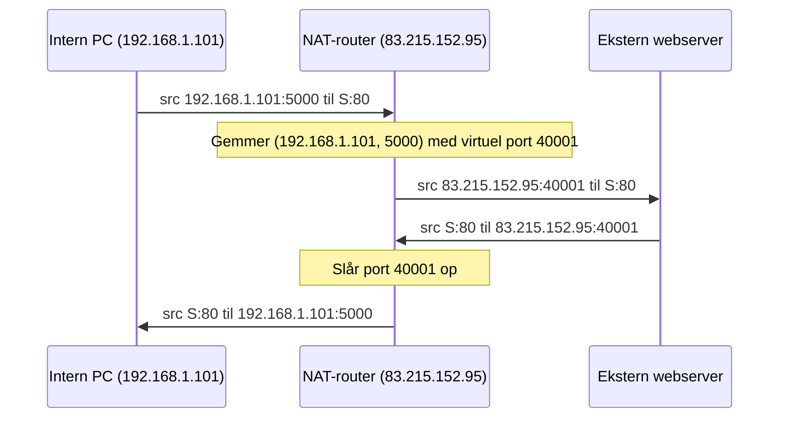
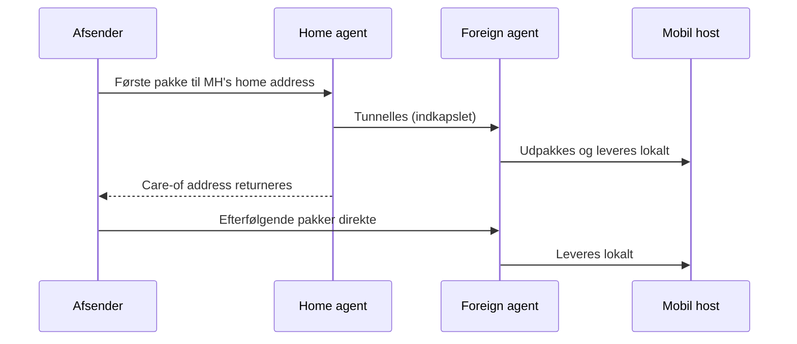

# Network layer og IP routing

Del af [[Netværk]], lag 3 nedefra i [[TCP-IP protocol stack]].

> Netværkslaget modtager data fra transportlaget og sender det (**datagrams**) **til næste stop mod destinationen** gennem **routing** *(Deitel 16.7)*.

## Routing

**En to-trins proces:** (1) bestem **næste host** mod destinationen, (2) send datagrammet ad den vej. **Routers** er computere, der forbinder netværk.

> **Den vigtigste sætning:** en router bestemmer næste host ud fra **sit eget øjebliksbillede af netværket**. Netværk ændrer sig hurtigt, så **en routers viden er ikke altid fuldstændig og opdateret** *(Deitel 16.7)*. Det er et grundvilkår, ikke en fejl, og svarer til fraværet af global tilstand i [[Fundamentale modeller]].

Beslutningen træffes ud fra topologi og **link quality** (signalstyrke, fejlrate, interferens).

| | Transportlaget | Netværkslaget |
|---|---|---|
| Perspektiv | **End-to-end** | **Ét hop** |
| Ved den, om destinationen er nået? | Ja | Nej, kender kun næste skridt |

### Routingprotokoller

| Protokol | Type | Kendetegn |
|---|---|---|
| **RIP-1** | Distance-vector | Internettets første routingalgoritme. Hver router sender **hele sin routing table** til sine naboer, indtil alle kender topologien *(Deitel 16.7)* |
| **RIP-2** | Distance-vector | Understøtter **CIDR**, bedre multicast og **autentificering** af RIP-pakker *(Coulouris 3.4.3)* |
| **OSPF** (Open Shortest Path First) | Link-state | Baseret på **Dijkstra**. **Konvergerer hurtigere** end RIP |

**Om RIP er der tre ting at vide:**
1. RIP er en **applikationslagsprotokol, der kører over UDP**: netværkslagets kontrolinformation bruger lagene over sig. Lagmodellen er en abstraktion, ikke et strengt hierarki *(Deitel 16.7)*
2. **Skalerer dårligt:** hver router holder hele topologien, og hele tabellen sendes, uanset om noget er ændret. Derfor næsten kun i mindre netværk. Distance-vector lider desuden af langsom konvergens og ustabilitet, så man er gået mod **link-state** *(Coulouris 3.4.3)*
3. **30-sekunders-problemet** (Floyd & Jacobson 1993): RIP-udvekslingen hvert 30. sekund fik routerne til at køre i **lock-step**, så latency toppede hvert 30. sekund. Løsningen var en **tilfældig periode på 15–45 sekunder**: randomisering bryder symmetri, ligesom Ethernets backoff ([[Link layer]])

**Nye algoritmer indføres inkrementelt:** hver RIP-pakke har et versionsnummer, IP-protokollen ændres ikke, og routere i samme **area** bruger samme algoritme. RIP-1 sameksisterer stadig med RIP-2 og OSPF.

### Backbones

*(Coulouris 3.4.3)*
Internettet er konceptuelt opdelt i **autonomous systems** (typisk en stor organisations intranet), som er opdelt i **areas**. Hvert AS har et **backbone area**; backbone-links har høj båndbredde og er replikerede. Hierarkiet bruges til administration og påvirker ikke, hvordan pakker routes.

### Routerkøer
Routere holder **køer**, fordi det tager tid at finde den bedste rute. **Når køen er fuld, droppes yderligere datagrammer**, uden varsel *(Deitel 16.7)*. Derfor er det transportlagets ansvar ikke at overrende dem: TCP's congestion control ([[Transport layer]]).

### Default routes

*(Coulouris 3.4.3)*
En fuld routingtabel til over en million destinationer er umulig. To løsninger:

1. **Topologisk gruppering af adresser** (fra 1993): nye adresser tildeles regionalt (fx 194.0.0.0–195.255.255.255 = Europa), så en router uden for Europa kan have **én tabelindgang** for hele intervallet. Adresser fra før 1993 er stadig spredt
2. **Default-indgang:** routinginformation kan være upræcis for de fleste routere, så længe nøglerouterne tæt på backbone har komplette tabeller

| To | Link | Cost |
|---|---|---|
| B | 2 | 1 |
| C | local | 0 |
| E | 5 | 1 |
| **Default** | **5** | – |

*Eksempel (node C):* pakker til D når frem uden tab; pakker til A tager et ekstra hop.

> **Default routing bytter routingeffektivitet for tabelstørrelse.** Ingen router på internettet har ruter til alle destinationer.

### Routing på et lokalt subnet
- Destinationen er på **samme netværk**: send i **ét hop**; **ARP** finder destinationens netværksadresse
- Destinationen er på **et andet netværk**: send til en **lokal router** (ARP finder routerens adresse)

Gateways og routere har **én IP-adresse pr. netværk**, de er forbundet til.

---

## IP

*(Deitel 16.7.1)*

**Internet Protocol** er den dominerende netværkslagsprotokol. Den vigtigste egenskab er sammenkoblingen: IP lader **mindre netværk blive kombineret til større**, så internettet bliver et netværk af netværk.

**IPv4:** 32-bit adresser (≈ 4 milliarder), skrevet som fire oktetter.

> ⚠️ Deitel skriver, at en 8-bit byte kan repræsentere 0 til 256. Korrekt er **0 til 255** (256 værdier).

**DNS** afbilder hostnavne til IP-adresser. Navnet er et **alias**, der er let at huske; det er IP-adressen, transport- og netværkslaget faktisk bruger. Detaljerne står i [[DNS]].

### CIDR

*(Coulouris 3.4.3)*
Indført 1996 på grund af adressemangel: der manglede **Class B**-adresser, mens der var masser af **Class C**. Løsningen er at tildele **en batch af sammenhængende Class C-adresser** (eller opdele et Class B-rum).

For at tabellerne ikke skal eksplodere, får routingtabellerne et **mask-felt**: et bitmønster, der udvælger den del af adressen, der sammenlignes. Host-delen kan være en vilkårlig del af adressen, deraf **classless**.

**Notation:** `138.37.95.232/29` = maske med 29 1'ere og 3 0'er, altså 8 adresser (232–239).

### NAT

*(Coulouris 3.4.3)*
Ikke alle enheder behøver en globalt unik adresse. Et hjemmenetværk får **én registreret IP** fra ISP'en, og interne enheder bruger **uregistrerede** adresser (de fleste via **DHCP**). Private blokke: **10.x.x.x**, **172.16.x.x**, **192.168.x.x**.

**Sådan virker det:** NAT-routeren har en **address translation table** og udnytter, at **kildeporten i en request bruges som destinationsport i svaret**.
1. En intern computer sender en pakke ud. Routeren gemmer **kilde-IP og kildeport** i en tabelplads
2. Routeren erstatter kildeadressen med sin egen og kildeporten med et **virtuelt portnummer**
3. Når svaret kommer, slår routeren den virtuelle port op og erstatter destinationsadresse og -port med de gemte værdier

En timer fjerner ubrugte indgange. **Begrænsning:** virker for **klienter**, ikke for **servere** bag routeren. Løsningen er **port forwarding** til én intern computer med fast IP pr. port.

> NAT var en kortsigtet løsning på adressemanglen. **IPv6** er den langsigtede.

### IPv6

*(Deitel 16.7.2)*
Antallet af netværksenheder får 32-bit adresserne til at slippe op, så IETF introducerede IPv6. (IPv5 blev foreslået, men aldrig implementeret.)

| | IPv4 | IPv6 |
|---|---|---|
| Adresselængde | 32 bit | **128 bit** |
| Antal adresser | ≈ 4 × 10⁹ | ≈ **3,4 × 10³⁸** |

| Adressetype | Leverer til |
|---|---|
| **Unicast** | **Én** host |
| **Anycast** | **Én hvilken som helst** af en gruppe, typisk den **nærmeste** |
| **Multicast** | **Alle** i en gruppe |

> **Anycast = én af dem (nærmeste), multicast = alle.** Anycast er reelt lastfordeling på adresseniveau.

Desuden **simplere headers** (hurtigere behandling i routere) og mulighed for **ekstra headers** (udvidelser).

### Tunneling
Overgangen til IPv6 er gradvis. For routere, der kun forstår IPv4, lægger IPv6-routere **IPv6-datagrammet ind i et IPv4-datagram**; en senere IPv6-router fjerner IPv4-indpakningen igen *(Deitel 16.7.2)*.

| Fordel | Ulempe |
|---|---|
| Routing fortsætter uden at udskifte al infrastruktur | Behandlingsoverhead i routerne |

> **Pak det nye ind i det gamle, når du ikke kan udskifte det gamle.** Samme mønster bruges af MobileIP (nedenfor) og IPsec/VPN ([[Sikre protokoller - TLS, IPsec og WiFi]]).

---

## MobileIP

*(Coulouris 3.4.5)*

**Problemet:** mobile enheder forbindes forskellige steder. Har de kun brug for at **bruge services** (klient), kan de få en ny IP hvert sted via **DHCP**. Skal de kunne **nås af andre**, skal de beholde én IP-adresse, men **IP-routing er subnetbaseret**, så adressen virker kun på det rigtige subnet. MobileIP løser det **transparent**.

Den mobile host har en permanent **home address** på sit hjemmesubnet.

| Agent | Placering | Ansvar |
|---|---|---|
| **Home agent (HA)** | Hjemmenetværket | Kender hostens aktuelle placering og fungerer som **proxy** under fraværet |
| **Foreign agent (FA)** | Det besøgte netværk | Tildeler en **care-of address** (midlertidig lokal IP) og leverer pakker lokalt |

**Forløbet:**
1. Hosten forlader hjemmet og informerer HA. HA beder lokale routere slette cachede oplysninger og **besvarer ARP-requests** for hosten med sin egen adresse
2. På det nye sted informerer hosten FA, som tildeler en care-of address og giver HA besked
3. Pakker til home address når HA, som **indkapsler** dem og **tunneller** dem til FA, der pakker ud og leverer
4. HA sender care-of address til afsenderen. Er afsenderen MobileIP-enabled, sender den direkte fremover; ellers går alt via HA

> **"Effektiv, men næppe effektivt":** omdirigering og tunneling koster. Mobilnettet gør det bedre: telefoner skifter ikke nummer, men melder bare deres tilstedeværelse til den lokale basestation.

MobileIP realiserer **mobility transparency** ([[Udfordringer i distribuerede systemer]]). MobileIP holder en **adresse** stabil, mens navnetjenester som DNS holder et **navn** stabilt og lader adressen bag det ændre sig ([[Navne og navneopløsning]]).

Default routes, CIDR og NAT er alle svar på **skalerbarhedsudfordringen** i distribuerede systemer.
