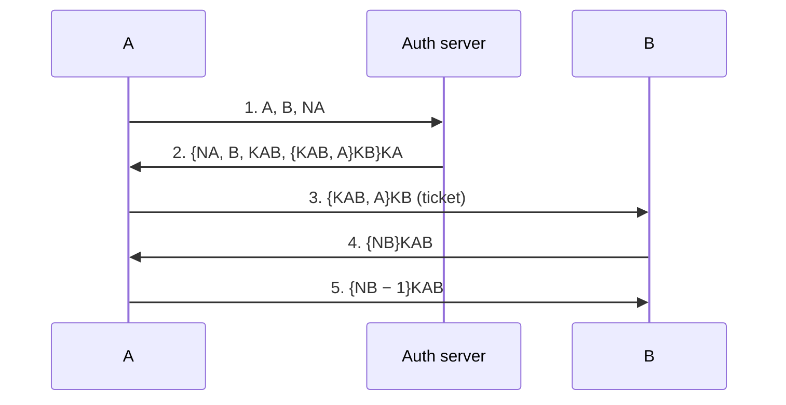
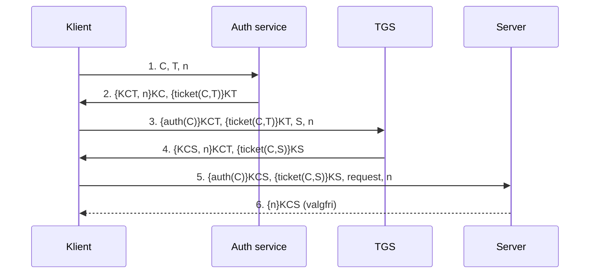

# Autentificering og Kerberos

Del af [[Sikkerhed]]. Autentificering besvarer **"hvem er du?"**. Hvad du så *må*, er autorisation → [[Access control]].

## De tre identifikationsfaktorer

*(Deitel 19.3)*

| Faktor | Eksempler | Svaghed |
|---|---|---|
| **Noget du er** | Fingeraftryk, stemme, iris | Svær at kopiere, **mindst sårbar over for eavesdropping** |
| **Noget du har** | Badge, nøgle, smart card | Kan **stjæles** |
| **Noget du ved** | Password, PIN | Bliver **skrevet ned** |

**Two-factor authentication** kombinerer to faktorer (fx smart card + PIN).

---

## Passwords: det mest udbredte og det svageste led

### Svaghederne

*(Deitel 19.3.1)*
- Brugere vælger **lette passwords** (ægtefælle, kæledyr)
- **Korte passwords** knækkes med **brute force**
- **Paradokset:** krav om lange, komplekse passwords får brugere til at **skrive dem ned**
- Tvungen udskiftning får brugere til at **rotere mellem 2–3 passwords**

> Passwordsikkerhed er lige så meget et **menneskeligt** problem som et teknisk. Hver skærpet regel skaber en ny adfærd, der underminerer den.

### Forsvarsmekanismerne

| Mekanisme | Beskytter mod |
|---|---|
| **Maskering** (\*\*\*) | Shoulder surfing |
| **Gem kun krypterede/hashede passwords** | At en stjålet password-fil kan bruges direkte. Ikke engang administratoren kan gendanne et password, kun sætte et nyt |
| **Salting** | At angriberen kan genkende mønstre fra almindelige passwords |
| **Begræns login-forsøg** | Brute force |
| **Shadow password file** | At alle kan læse de krypterede passwords |

**Salting i UNIX** *(Deitel 19.13)*: en tilfældig streng på 2 tegn (ud fra tid og proces-ID), hvoraf 12 bits modificerer krypteringsalgoritmen. Brugere med **samme password** får derfor **forskellige krypterede værdier**.

> ⚠️ Deitels figur 19.5 bruger Base64 til at illustrere salting, men Base64 er en **kodning**, ikke kryptering. Pointen er kun, at lidt salt ændrer outputtet markant.

**Shadow password file** *(Deitel 19.13)*: password-filen **skal** være læsbar for alle, fordi fx `ls` skal oversætte user-ID → brugernavn. Derfor flyttes de krypterede passwords til en separat shadow-fil, som kun **root** kan læse. Et godt eksempel på **least privilege**: filen deles, så hver del kun er så tilgængelig som nødvendigt.

**Password aging og dets bagside:** brugere vælger svage passwords, systemet forhindrer ofte skift i en uge, og brugere skifter mellem kun to. Flere bagsider af password-forsvar står i [[Forsvarsmekanismer#UNIX-sikkerhed|UNIX-casen]].

## Biometri og smart cards

*(Deitel 19.3.2)*
**Biometri:** scanningen gemmes i en sikker database og sammenlignes ved hvert login. **Layered biometric verification (LBV)** kombinerer flere målinger.

| Smart card-type | Indhold |
|---|---|
| **Memory card** | Lagrer og overfører data |
| **Microprocessor card** | Eget OS, sikkerhed + lager. Kan **slette data ved manipulation** |

Interface: **contact** (indsættes) eller **contactless** (trådløst). Smart cards kan lagre **private keys og certifikater** og bruges med en PIN (noget du har + noget du ved).

---

## Autentificering uden at sende passwordet

**Needham og Schroeders gennembrud: the challenge** *(Coulouris 11.2, scenarie 2)*. Passwordet sendes aldrig. I stedet sender en authentication server noget **krypteret med en nøgle afledt af passwordet**. Kun den rigtige bruger kan dekryptere svaret; en bedrager kommer ikke videre.

Det kræver en **authentication server**, der på forhånd kender alles nøgler. Fint inden for én organisation, urealistisk til e-handel (der bruges public-key + certifikater i stedet). Idéen er den samme som en [[Kryptografi|KDC]].

**Nonce:** et tal, der **kun bruges én gang** (tæller eller klokkeslæt) og beviser, at en besked er **frisk**. Det er forsvaret mod **replay** ([[Trusler og angreb]]).

## Needham-Schroeder (1978), secret-key-versionen

*(Coulouris 11.6.1)*

Server S har en tabel med **navn + secret key** for hver principal (svarer til et password).

| # | Besked | Formål |
|---|---|---|
| 1 | `A → S: A, B, NA` | A beder om en nøgle til B |
| 2 | `S → A: {NA, B, KAB, {KAB, A}KB}KA` | Krypteret med A's nøgle, så A ved, det er S. **NA** viser, at det er svaret på netop besked 1. Indeholder en **ticket** `{KAB, A}KB`, som A **ikke kan læse** |
| 3 | `A → B: {KAB, A}KB` | A videresender ticket'en |
| 4 | `B → A: {NB}KAB` | B beviser, at B har KAB, og udfordrer A |
| 5 | `A → B: {NB − 1}KAB` | A beviser, at A var afsender af besked 3 |

**Hvorfor `NB − 1`?** Sender A blot `{NB}KAB` tilbage, kunne en angriber gentage besked 4 uden at kende KAB. Transformationen beviser, at afsenderen **faktisk har dekrypteret** NB.

**Svagheden: besked 3 er ikke frisk.** En angriber med en **gammel KAB** og den tilhørende ticket kan genspille besked 3 og udgive sig for A. Needham og Schroeder havde ikke "kompromitterede gamle session keys" på trusselslisten; i dag skal man have det. **Rettelsen:** et timestamp i ticket'en, `{KAB, A, t}KB`. **Det er Kerberos' løsning.**

(Der findes også en public-key-version, og **TLS er en variant af den**.)

---

## Kerberos

*(Coulouris 11.6.2)*

MIT, 1980'erne (Project Athena). Version 5 er internetstandard (RFC 4120) og **standard-autentificeringen i Windows**. Designet til et miljø, hvor man **hverken kan stole på klienter, netværk eller servere**. Bruger **secret-key-kryptografi** og er en KDC.

**Motivation** *(Deitel 19.3.3)*: 70–90 % af angreb på virksomhedsnetværk er **interne**, og et centralt autentificeringssystem giver hurtig reaktion.

### Sikkerhedsobjekterne

| Objekt | Laves af | Indhold | Levetid |
|---|---|---|---|
| **Ticket** | TGS | Klientnavn, server, gyldighedsperiode t1–t2, ny session key | Timer (typisk ~12 t) |
| **Authenticator** | **Klienten** | Klientnavn + **timestamp**, krypteret med session key | **Kun én gang** |
| **Session key** | Kerberos | Tilfældig secret key til klient ↔ server | Som ticket'en |

Ticket-format: `{C, S, t1, t2, KCS}KS`. **Klientens navn er med**, så andre ikke kan bruge den.

KDC'en består af en **Authentication Service (A)** (ved login) og en **Ticket-Granting Service (T)** (udsteder tickets til konkrete servere).

### Protokollen

| # | Besked | Note |
|---|---|---|
| **A. Ved login** | | |
| 1 | `C → A: C, T, n` | **Ukrypteret, og intet password** |
| 2 | `A → C: {KCT, n}KC, {ticket(C,T)}KT` | Session key til TGS + TGS-ticket. Ticket'en er krypteret med **TGS'ens nøgle**, så C kan **ikke** læse den. Hele beskeden er en **challenge**: kun brugbar med KC (afledt af passwordet) |
| **B. Pr. klient-server-session** | | |
| 3 | `C → T: {auth(C)}KCT, {ticket(C,T)}KT, S, n` | Authenticator + TGS-ticket + ønsket server |
| 4 | `T → C: {KCS, n}KCT, {ticket(C,S)}KS` | Ny session key KCS og en ticket til S |
| **C. Hver request** | | |
| 5 | `C → S: {auth(C)}KCS, {ticket(C,S)}KS, request, n` | Ny authenticator hver gang |
| **D. (Valgfrit)** | | |
| 6 | `S → C: {n}KCS` | Autentificerer serveren |

> **Mønsteret:** hvert trin giver en **session key + en ticket til næste trin**. Ticket'en er krypteret med **modtagerens** nøgle, session key'en med en nøgle **klienten** kender. Det er Needham-Schroeders besked 2, gentaget to gange.

> ⚠️ **Deitels version er forkert** *(Deitel 19.3.3)*: Deitel skriver, at klienten sender brugernavn **og password**, og at TGT'en er krypteret med klientens nøgle. I den rigtige protokol sendes passwordet **aldrig**, og TGT'en er krypteret med **TGS'ens nøgle**. Brug Coulouris' version.

**Hvorfor to trin (A og T)?** Passwordet bruges kun **én gang**, ved login, og kan derefter slettes fra hukommelsen. Alle senere server-tickets hentes med TGS-ticket'en.

**Tidsværdier har to formål:** (1) beskytte mod **replay** og genbrug af gamle tickets, (2) give tickets en **levetid**, så rettigheder kan tilbagekaldes. Udløb tvinger også re-autentificering, hvis nogen forlader en terminal *(Deitel 19.3.3)*.

**Skalering:** verden deles i **realms** med hver sin Kerberos-server; inden for et realm er databasen **master-slave-replikeret**.

### Kritik

| Kritik | Detalje |
|---|---|
| **Kræver løst synkroniserede ure** (v4) | Og synkroniseringsprotokollen skal selv være sikker |
| **Servere skal huske nonces** (v5) | Besværligt og svært at garantere ved crash |
| **Ticket-levetid er en afvejning** | Lang nok til ikke at afbryde brugeren, kort nok til at tilbagekaldelse virker |

> **Kerberos vs. TLS:** Kerberos er **secret-key** og forudsætter **én fælles administration**, der kender alles nøgler. TLS er **hybrid** og virker **uden tidligere kontakt**, hvilket internettet kræver → [[Sikre protokoller - TLS, IPsec og WiFi]].

---

## Single sign-on (SSO)

*(Deitel 19.3.4)*

Log ind **én gang** og få adgang til mange applikationer. **Bagsiden:** lækker det ene password, er **alle** applikationer åbne.

| Variant | Hvordan | Sikkerhed |
|---|---|---|
| **Workstation login scripts** | Scriptet på klienten sender passwordet videre | **Svagest** (password ofte i plaintext lokalt). Men et kompromitteret script rammer kun **én bruger** |
| **Authentication server scripts** | Central server styrer forbindelserne | Bedre, men kompromitteres serveren, **falder hele systemet** |
| **Token-based** | Unikt token pr. applikation efter login | **Sikrest, men mest kompleks**. Applikationerne skal ændres. Kerberos' service ticket er et token |

> Centralisering (KDC, auth-server, CA) beskytter hemmeligheden bedre, men skaber et **single point of failure**.

Andre aktører: Liberty Alliance, Microsoft .NET Passport, Novell SecureLogin. **P3P** lader brugeren styre, hvilke personlige oplysninger sites indsamler.
