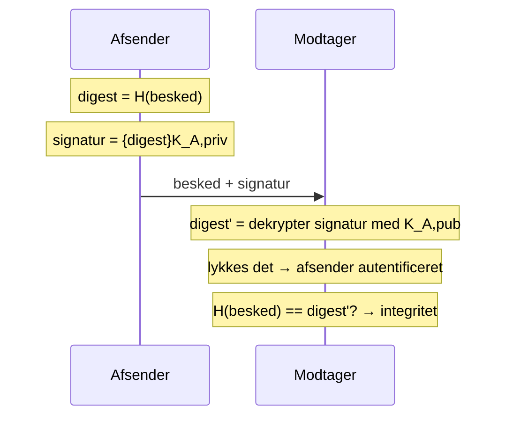

# Hashing, digitale signaturer og MAC'er

Del af [[Sikkerhed]]. Bygger på [[Kryptografi]]. Her løses **integrity**, **authentication** og **nonrepudiation**.

## Hvad en signatur skal kunne

*(Coulouris 11.4)*

| Egenskab | Betydning |
|---|---|
| **Authentic** | Underskriveren har **bevidst** signeret, og dokumentet er **ikke ændret** siden |
| **Unforgeable** | Kun underskriveren kan have gjort det. Signaturen kan **ikke flyttes** til et andet dokument |
| **Non-repudiable** | Underskriveren kan ikke troværdigt **nægte** at have signeret |

Digitale dokumenter er trivielle at kopiere og ændre, så et navn eller et indscannet underskriftsbillede har **ingen værdi**. Signaturen skal **bindes uløseligt til hele bitsekvensen**. Derfor er en digital signatur faktisk stærkere end en håndskreven: den er beregnet ud fra **dokumentets indhold** og kan ikke klippes over på et andet *(Deitel 19.8.2)*.

---

## Secure digest functions (hash)

En **XOR-checksum** er god til fejldetektion (se [[Link layer]]), men **ubrugelig** til signaturer. En secure digest `h = H(M)` skal opfylde *(Coulouris 11.4.3)*:

1. Givet M er h **let** at beregne
2. Givet h er M **svær** at finde
3. Givet M er det **svært at finde M'**, så `H(M) = H(M')`

(1) og (2) giver navnet **one-way hash function**. (3) er nødvendig, fordi en digest **må** have kollisioner (den reducerer information), men en angriber må ikke kunne **finde** en, ellers kan signaturen flyttes fra M til M'.

Hash-funktioner behøver ikke kunne vendes, så de kan bruge alle aritmetiske og logiske operationer, i modsætning til krypteringsalgoritmer. De er typisk **3–10× hurtigere** end symmetrisk kryptering.

### Birthday attack
1. Alice laver kontrakt **M** (god for Bob) og **M'** (dårlig for Bob)
2. Alice laver mange **visuelt ens varianter** af begge (fx mellemrum) og leder efter et **par**, der hasher ens
3. Bob signerer M, og Alice **flytter signaturen** til M'

> **Fødselsdagsparadokset:** at finde **et hvilket som helst par** er langt lettere end at matche **en bestemt** værdi. 23 personer giver 50 % chance for to med samme fødselsdag, men der skal 253 til for 50 % chance for én på **en bestemt** dag.
>
> **Konsekvens:** et birthday attack **halverer den effektive bitlængde**. En 64-bit hash kræver kun ca. 2³² forsøg, så **hashes skal være mindst 128 bit**.

### Algoritmer

| | Digest | Kendetegn |
|---|---|---|
| **MD5** (Rivest) | 128 bit | 4 runder over 512-bit blokke. Meget effektiv |
| **SHA-1** (NIST) | 160 bit | Langsommere, men mere modstandsdygtig. Planlagt udfaset til SHA-224/256/512 |

En digest kan også laves med en symmetrisk algoritme i **CBC-mode** med en offentliggjort nøgle *(Coulouris 11.4.3)*.

---

## Digitale signaturer med public keys

Kræver **ingen kommunikation** mellem modtager og underskriver eller en tredjepart *(Coulouris 11.4.1)*.

1. A beregner `H(M)` og krypterer med sin **private key**: `S = {H(M)}KApriv`
2. A sender `M, S` (et signeret dokument skrives `[M]KA`)
3. B dekrypterer S med **KApub**, beregner selv `H(M)` og sammenligner

| Trin | Opnår |
|---|---|
| Dekrypter signaturen med **afsenderens public key** | **Autentificering** (kun afsender har private key'en) |
| Sammenlign egen hash med den signerede digest | **Integritet** |

Deitel lader desuden selve beskeden være krypteret med modtagerens public key, så man også får **privacy** *(Deitel 19.8.2)*. USA's standard er **DSA**, og fra juni 2000 er digitale signaturer juridisk bindende i USA.

## MAC'er: signaturer med secret keys

*(Coulouris 11.4.2)*

En secret key *kan* bruges til at signere, men nøglen skal sikkert til verifikatoren, og **alle, der kan verificere, kan også forfalske**. Undtagelsen er **inden for en sikker kanal** mellem to parter, der allerede deler en nøgle. Her bruges billige **Message Authentication Codes**:

1. A og B deler en hemmelig nøgle K
2. A beregner `h = H(M + K)` og sender `M, h`. K afsløres ikke, fordi hashen skjuler den
3. B beregner `h' = H(M + K)`. Gyldig, hvis `h = h'`

Der er **ingen kryptering**, kun hashing. Bruges i **TLS** og i **Millicent** (micro-payments).

| | Public-key-signatur | MAC |
|---|---|---|
| Nøgle | Privat (signer) / offentlig (verificer) | **Delt** hemmelighed |
| Hvem kan verificere | **Alle** | Kun dem med nøglen |
| Hvem kan forfalske | Kun ejeren | **Alle med nøglen** |
| Non-repudiation | Ja (i princippet) | **Nej** |
| Pris | Dyr | **Billig** |
| Brug | Dokumenter, certifikater | Beskeder inden for en sikker kanal |

---

## Hvad en signatur ikke giver alene

1. **Tidspunktet:** modtageren ved kun, at dokumentet blev signeret **før** modtagelsen *(Coulouris 11.4)*
2. **Fuld non-repudiation:** hvad hvis underskriveren **selv lækker sin private key** og siger "det kunne være hvem som helst"?
3. **"Original"** giver ingen mening digitalt, så signaturer forhindrer ikke **double spending** af elektroniske penge

### Time stamping

*(Deitel 19.8.2)*
**Scenariet:** en entreprenør vil fortryde en signeret kontrakt, lækker selv sin private key og påstår, at en angriber har signeret.

**Løsningen:** en **time-stamping agency / digital notary**:
1. Den signerede (og krypterede) kontrakt sendes til agenturet, som **kun ser ciphertext**
2. Agenturet påfører dato/tid og **signerer det hele med sin egen private key**
3. Medmindre lækagen blev **meldt før tidsstemplet**, kan entreprenøren ikke bevise, at en uvedkommende signerede

> Signaturen siger **hvem**, tidsstemplet fra en betroet tredjepart siger **hvornår**. (Coulouris nævner *undeniable signatures* som alternativ, men de er komplekse.)

**Phantom withdrawal** *(Coulouris 11.1)*: en kunde påstår, at en hævning ikke var kundens. Banken kan kun forsvare sig med en **digitalt signeret transaktionslog**. Sikkerhed handler også om at kunne **bevise**, at systemet ikke er brudt.
