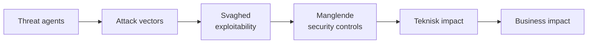

# OWASP Top 10

Del af [[Sikkerhed]]. De ti mest kritiske sikkerhedsrisici for **webapplikationer**, set fra udviklerens side. Hvor [[Trusler og angreb]] handler om angreb på systemer og netværk, handler OWASP om de fejl, **vi selv bygger ind** i koden, designet og driften.

*(OWASP Intro, About)*
- **OWASP** = Open Worldwide Application Security Project: et åbent non-profit-fællesskab, hvor alt materiale er gratis (cheat sheets, ASVS, SAMM, Juice Shop, WebGoat). OWASP ser sikkerhed som et problem om **mennesker, processer og teknologi**.
- **Top 10** er et **awareness-dokument**, ikke en komplet standard. 2025 er 8. udgave, bygget på data fra over **2,8 mio. applikationer**.

## Listen 2025

*(OWASP Intro)*

| # | Kategori | Ændring fra 2021 |
|---|---|---|
| **A01** | Broken Access Control | Fortsat #1. **SSRF** er lagt ind her |
| **A02** | Security Misconfiguration | ↑ fra #5. Mere og mere adfærd styres af konfiguration |
| **A03** | Software Supply Chain Failures | **Ny/udvidet**, fra "Vulnerable and Outdated Components". Survey #1 |
| **A04** | Cryptographic Failures | ↓ fra #2 |
| **A05** | Injection | ↓ fra #3 (inkl. XSS) |
| **A06** | Insecure Design | ↓ fra #4. Bedre threat modeling i branchen |
| **A07** | Authentication Failures | Fortsat #7, før "Identification and Authentication Failures" |
| **A08** | Software or Data Integrity Failures | Fortsat #8 |
| **A09** | Security Logging & Alerting Failures | Fortsat #9, før "...Monitoring...". Survey-valgt |
| **A10** | Mishandling of Exceptional Conditions | **Ny** |

> **Huskeregel:** de tre øverste er **adgang, konfiguration og afhængigheder**. Altså ting rundt om koden, ikke klassiske kodefejl som injection.

## Sådan er listen lavet

*(OWASP Intro, What are Application Security Risks)*

**Data-informeret, ikke blindt datadrevet.** 8 kategorier vælges ud fra testdata, **2 ud fra en community survey** (A03 og A09). Grunden: data ser **bagud**. Det tager år, før en ny type sårbarhed kan testes automatisk i stor skala, og nogle risici (fx manglende logging) kan måske aldrig testes.

**Root cause frem for symptom.** Kategorierne er grupper af **CWE'er** (Common Weakness Enumeration), i alt 248 CWE'er, mellem 5 og 40 pr. kategori. Man foretrækker årsager ("Cryptographic Failure") frem for symptomer ("Sensitive Data Exposure", "Denial of Service"). Derfor blev 2021's DoS omdøbt til *Lack of Application Resilience*.

**Hvorfor ikke bare 10 CWE'er?** Ikke alle CWE'er findes i alle sprog, og samme sårbarhed har ofte flere CWE'er (fx findes der mange for injection).

**Incidence rate, ikke frekvens:** man tæller *hvor mange procent af applikationerne* der har mindst én forekomst. Om en app har 4 eller 4.000 forekomster er ligegyldigt, fordi manuelle testere skriver en fejl én gang, mens værktøjer skriver hver forekomst.

**Risikoscore** (exploit og impact er CVSS v2/v3-delscorer fra CVE'er i NVD):
```
(Max Incidence % × 1000) + (Max Coverage % × 100)
+ (Avg Exploit × 10) + (Avg Impact × 20) + (Occurrences / 10000)
```
Scoren gik fra 621,60 (Broken Access Control) ned til 271,08 (Memory Management). CVSS v4 bruges ikke endnu, fordi den ikke giver separate exploit- og impact-scorer.

### Risikomodellen


Exploitability, sandsynligheden for manglende kontroller og teknisk impact er **universelle**. Threat agents og business impact afhænger af **organisationen**: samme CMS bruges til offentlig info og til patientjournaler med vidt forskellig risiko.

## A01 Broken Access Control

*(OWASP A01)*
Brugere kan handle **uden for deres tilladelser**. **100 %** af de testede apps havde en form for det. Teorien bag står i [[Access control]].

**Typiske fejl:**
- Ingen **deny by default** (brud på least privilege)
- **Parameter tampering / force browsing**: ændre URL'en eller gætte admin-sider
- **IDOR** (Insecure Direct Object Reference): se en andens konto ved at ændre et ID
- API uden adgangskontrol på POST/PUT/DELETE
- Manipulation af **JWT**, cookies eller skjulte felter for at hæve rettigheder
- Fejlkonfigureret **CORS**
- Også **CSRF** og **SSRF** hører hertil

**Forebyggelse:** adgangskontrol **kun i betroet server-side kode**. Deny by default, implementér mekanismen **én gang** og genbrug den, håndhæv **record ownership**, slå directory listing fra, log og alarmér ved fejl, rate-limit API'er, invalidér sessioner ved logout og brug kortlivede JWT'er. Test adgangskontrol i unit- og integrationstests.

```java
pstmt.setString(1, request.getParameter("acct"));   // ?acct=notmyacct → andens konto
```
> **Adgangskontrol i frontenden er ingen adgangskontrol.** Skjuler JavaScript admin-siden, kalder angriberen den bare med `curl`.

## A02 Security Misconfiguration

*(OWASP A02)*
Systemet er sat forkert op ud fra et sikkerhedssynspunkt. Det findes også i 100 % af apps og omfatter bl.a. **XXE** (XML External Entities).

**Typiske fejl:** manglende hardening, unødvendige features/porte/konti, **default-konti med default-passwords**, **stack traces vist til brugeren**, manglende security headers, åbne cloud-rettigheder (fx S3), og bagudkompatibilitet, der går forud for sikkerhed.

**Forebyggelse:** en **automatiseret, gentagelig hardening-proces**, hvor dev, QA og prod er konfigureret ens (men med forskellige credentials). Minimal platform, segmenteret arkitektur, security headers, central opsnapning af fejlbeskeder, og kortlivede credentials frem for hemmeligheder i kode.

**Eksempler:** sample-apps med admin-konsol og default-password i produktion · directory listing → download af .class-filer → decompile → find access control-fejl · cloud-deling, der er åben som default.

## A03 Software Supply Chain Failures

*(OWASP A03)*
Kompromittering i processen med at **bygge, distribuere eller opdatere** software, typisk via tredjepartskode, værktøjer eller afhængigheder. Den har **få CVE'er** (svær at teste), men den **højeste gennemsnitlige incidence rate** og de højeste exploit- og impact-scorer. Halvdelen af survey-deltagerne satte den som #1.

**Sårbar, hvis du:** ikke kender versionerne af alle komponenter (også **transitive** afhængigheder), kører forældet software, ikke scanner, ikke sporer ændringer i hele kæden (inkl. IDE-extensions), mangler **separation of duties** (én person kan skrive kode og selv sende den i produktion), eller har en CI/CD-pipeline, der er **svagere sikret end det, den bygger**.

**Forebyggelse:**
- **SBOM** (Software Bill of Materials) for al software
- Kontinuerlig scanning mod CVE/NVD/OSV (fx OWASP Dependency-Check)
- Kun officielle kilder, gerne **signerede pakker**, se [[#A08 Software or Data Integrity Failures|A08]]
- **Staged rollouts / canary deployments**, så en kompromitteret leverandør ikke rammer alt på én gang
- Hærd repo, udviklermaskiner, build-server og artefakter (MFA, signerede builds, uforanderlige artefakter)

| Case | Pointe |
|---|---|
| **SolarWinds** (2019) | Betroet leverandør kompromitteret → ~18.000 organisationer ramt |
| **Bybit** (2025) | Wallet-software var kun ondsindet under en bestemt betingelse → $1,5 mia. stjålet |
| **Shai-Hulud** (2025) | Første selvspredende **npm-orm**: stjal npm-tokens og udgav nye ondsindede versioner. **Udviklere er nu selv mål** |
| **Log4Shell**, Struts 2 | Komponenter kører med appens rettigheder, så én sårbar lib giver RCE |

## A04 Cryptographic Failures

*(OWASP A04)*
Manglende eller svag kryptografi, lækkede nøgler og **svag tilfældighed** (flere af de hyppigste CWE'er handler om svage PRNG'er). Grundlaget står i [[Kryptografi]] og [[Hashing, digitale signaturer og MAC'er]].

**Krav i 2025:**
- Al trafik over **TLS ≥ 1.2** med **forward secrecy** og **HSTS**. Drop CBC-ciphers. Se [[Sikre protokoller - TLS, IPsec og WiFi|TLS]]
- **Authenticated encryption** frem for kryptering alene. Aldrig ECB, og aldrig samme IV to gange med samme nøgle
- **Passwords:** adaptiv, saltet hashing med work factor: **Argon2, yescrypt, scrypt, PBKDF2-HMAC-SHA-512**. Ikke MD5/SHA1
- Brug passwords som nøgler kun via en **key derivation function**. Brug **CSPRNG** og seed den ikke selv med lav entropi
- Gem ikke følsomme data unødigt ("data, der ikke gemmes, kan ikke stjæles"). Følsomme svar må ikke caches
- Nøgler i **HSM**, ingen nøgler i repoet
- Forbered **post-quantum cryptography**, så højrisikosystemer er klar senest **2030**

**Eksempler:** intet tvunget TLS → downgrade til HTTP → stjålen session-cookie (session hijacking) · usaltede hashes → **rainbow tables**. Hurtige hashes knækkes på GPU'er, selv med salt.

## A05 Injection

*(OWASP A05)*
Upålideligt input sendes til en **fortolker** (database, browser, shell), som udfører en del af det som **kommando**. Kategorien har **flest CVE'er** af alle: XSS (hyppig, lav impact, >30k CVE'er) og SQL injection (sjældnere, høj impact, >14k).

**Typer:** SQL, NoSQL, OS command, ORM/HQL, LDAP, EL/OGNL og **XSS**. **Prompt injection** i LLM'er dækkes af den separate OWASP LLM Top 10.

```java
String query = "SELECT * FROM accounts WHERE custID='" + request.getParameter("id") + "'";
// id = ' OR '1'='1   →  alle rækker returneres
String cmd = "nslookup " + request.getParameter("domain");   // example.com; cat /etc/passwd
```

**Forebyggelse:** **hold data adskilt fra kommandoer.**
1. **Bedst:** et sikkert API med **parameteriserede queries** (prepared statements) eller ORM
2. Ellers: **positiv server-side inputvalidering** (allow-list) og **escaping** for netop den fortolker

> ⚠️ **Frameworks redder dig ikke automatisk.** HQL med string-konkatenering er stadig sårbar, og stored procedures kan stadig give SQL injection, hvis de selv konkatenerer (`EXECUTE IMMEDIATE`). Tabel- og kolonnenavne kan ikke escapes.

**Find det** med kode-review plus **SAST/DAST/IAST** og fuzzing i CI/CD.

## A06 Insecure Design

*(OWASP A06)*
**Manglende eller ineffektive kontroller i designet**, ikke fejl i implementeringen.

> **Skellet:** et sikkert design kan have implementeringsfejl, men **et usikkert design kan ikke reddes af en perfekt implementering**, fordi kontrollen aldrig blev designet. Det svarer til Coulouris' pointe om, at sikkerhed skal tænkes ind fra designstart, se [[Sikkerhed#Design af sikre systemer]].

**Tre dele:** krav og ressourcestyring (CIA-krav, budget til sikkerhed) → **secure design** (threat modeling i refinement, flow- og fejltilstande skrevet ind i **user stories**) → **secure development lifecycle** (paved roads, sikre komponentbiblioteker, post-mortems).

**Forebyggelse:** threat modeling af login, adgangskontrol og forretningslogik · sikkerhed i user stories (se [[User stories]]) · plausibilitetstjek i alle lag · **misuse cases** ved siden af use cases · adskil lag og tenants.

**Eksempler:** sikkerhedsspørgsmål til password-gendannelse (forbudt af NIST 800-63b, fordi flere kan kende svaret) · gruppebooking på 600 biografsæder uden depositum · scalper-bots, der køber alle grafikkort.

## A07 Authentication Failures

*(OWASP A07)*
Systemet kan narres til at acceptere en forkert bruger som legitim. Teorien står i [[Autentificering og Kerberos]].

**Angrebene:**
- **Credential stuffing:** lækkede brugernavn/password-par prøves af
- **Hybrid credential stuffing / password spray:** lækkede passwords "tælles op" (`Winter2025` → `Winter2026`)
- Brute force, default-passwords (`admin`/`admin`), svag gendannelse, plaintext eller svagt hashede passwords
- **Session fixation** (samme session-ID før og efter login), session-ID i URL'en, manglende logout/timeout og **SSO uden Single Logout**

**Forebyggelse:**
- **MFA** overalt, hvor det er muligt. Passwords som eneste faktor er årsagen til de fleste succesfulde angreb
- Tjek nye passwords mod top-10.000-lister og **kendte lækager** (haveibeenpwned)
- **Følg NIST 800-63b:** tving **ikke** password-skift, medmindre der er mistanke om brud
- Samme fejlbesked for alt ("Invalid username or password"), så man ikke kan **enumerere konti**
- Ny tilfældig session-ID efter login, i en secure cookie, invalideret ved logout, idle og absolut timeout
- Valider JWT-claims (`aud`, `iss`, scopes). Køb hellere et velafprøvet identitetssystem end at bygge selv

> ⚠️ **Rotation og kompleksitetskrav er ikke længere best practice.** De får brugere til at genbruge og svække passwords. Det stemmer med Deitels observation om brugere, der roterer mellem 2–3 passwords, men OWASP og NIST konkluderer, at man skal **droppe** tvungen rotation, se [[Autentificering og Kerberos#Svaghederne]].

## A08 Software or Data Integrity Failures

*(OWASP A08)*
Kode eller data behandles som **betroet uden at integriteten er verificeret**. Det ligger på et lavere niveau end A03.

**Eksempler:**
- **Auto-update uden signatur** (routere, firmware): angriberen distribuerer sin egen opdatering
- Pakke hentet fra en tilfældig hjemmeside i stedet for package manageren
- **CNAME til en tredjepart** (`support.myCompany.com` → leverandøren), så alle cookies på `myCompany.com` sendes til leverandøren → session hijacking
- **Insecure deserialization:** serialiseret Java-state sendes frem og tilbage (`rO0` i base64) → **remote code execution**

**Forebyggelse:** **digitale signaturer** på software og data (se [[Hashing, digitale signaturer og MAC'er]]), kun betroede repositories (eventuelt et internt vettet repo), review af kode- og konfigurationsændringer, og en adskilt, adgangskontrolleret CI/CD-pipeline. Usigneret serialiseret data fra klienter må aldrig bruges uden integritetstjek.

## A09 Security Logging & Alerting Failures

*(OWASP A09)*
Navneskiftet til **Alerting** er pointen: **god logging uden alarmer er næsten værdiløs**. Kategorien er svær at teste og er derfor altid underrepræsenteret i data; den er valgt via survey tre gange.

**Fejlene:** login-fejl og værdifulde transaktioner logges ikke · logs kun lokalt · logs kan manipuleres · ingen alarmtærskler · pentests og DAST-scanninger udløser ingen alarm · **følsomme data (PII) i loggen** · **log injection** (manglende output-encoding) · for mange false positives, så SOC'en drukner.

**Forebyggelse:** log alle security controls (succes og fejl) med brugerkontekst · format, som log-værktøjer kan læse · encode log-data · **append-only audit trail** · **honeytokens** (falske data/brugere, som kun en angriber rører, så alarmen næsten aldrig er falsk) · playbooks og en incident response-plan (NIST 800-61). Værktøjer: ELK-stakken, ModSecurity.

**Case:** et sundhedsforsikringsselskab for børn opdagede ikke et brud på 3,5 mio. journaler i **over 7 år**. En ekstern part fortalte dem det.

Kobler til security log og audit i [[Sikkerhed#Design af sikre systemer]] og IDS i [[Forsvarsmekanismer]].

## A10 Mishandling of Exceptional Conditions

*(OWASP A10)*
Ny i 2025. Programmet **forhindrer, opdager eller reagerer ikke** på unormale situationer og ender i en ukendt tilstand. Kategorien samler CWE'er, der før blot hed "dårlig kodekvalitet": **fejlbesked med følsomme data**, manglende parametre, NULL pointer og **failing open**.

**Forebyggelse:**
- Fang fejl **der, hvor de opstår**, og håndtér dem meningsfuldt; hav desuden en **global exception handler**
- **Fail closed:** rul **hele transaktionen** tilbage frem for at reparere halvvejs, se [[Transaktioner og ACID]]
- **Intet må være ubegrænset:** rate limits, kvoter og throttling
- Én central, ens måde at håndtere fejl på i hele organisationen

| Eksempel | Hvad går galt |
|---|---|
| Upload-exception frigiver ikke ressourcer | Ressourcerne løber tør → **DoS** |
| Databasefejl vises til brugeren | Gratis **rekognoscering** til SQL injection |
| Afbrudt flertrinsoverførsel (debit → kredit → log) | Uden rollback: tømt konto eller dobbelt overførsel (**race condition**) |

## Lige uden for listen

*(OWASP Next Steps)*

| | Kategori | Kort |
|---|---|---|
| **X01** | Lack of Application Resilience | Tidligere "DoS". Design for fejl: limits, timeouts, **circuit breakers, bulkheads**, graceful degradation, load testing og chaos engineering. Se [[Trusler og angreb#Denial of Service]] |
| **X02** | Memory Management Failures | Buffer overflow, use-after-free, format strings (`syslog(user_input)`). **Bedste forsvar: memory-safe sprog** (Java, C#, Rust, Go). Ellers ASLR, DEP, canaries og fuzzing. Se [[Trusler og angreb#Buffer overflow]] |
| **X03** | Inappropriate Trust in AI Generated Code (**vibe coding**) | Ingen CWE'er endnu, men AI-kode har flere sårbarheder. **Du er ansvarlig for al kode, du committer**, så du skal kunne læse og forstå den. Review den, brug SAST, og vibe-code ikke kritiske eller langlivede systemer |

## Et moderne AppSec-program

*(OWASP Establishing a Modern AppSec Program)*

Top 10 er kun et **minimum**. Har man et program, så vurdér modenheden med **OWASP SAMM** eller **DSOMM**. Starter man forfra:

1. **Risikobaseret portefølje:** klassificér apps efter forretningsbehov, brug en fælles risikomodel og registrér alt i CMDB'en
2. **Stærkt fundament:** policies, genbrugelige security controls og rollerettet træning
3. **Integrér i eksisterende processer:** mindst én sikkerhedsaktivitet i hver SDLC-fase
4. **Uddannelse:** security champions, Juice Shop og WebGoat
5. **Synlighed for ledelsen:** styr efter metrics

**Sikkerhed gennem hele livscyklussen:**

| Fase | Nøgleaktiviteter |
|---|---|
| Krav | CIA-krav, **ASVS** som kravkatalog, budget til sikkerhed |
| Design | Threat modeling, data flows, **security user stories**, OWASP Proactive Controls |
| Udvikling | Code review, SAST, SCA, secret- og IaC-scanning, **paved roads** (den nemmeste vej er den sikre), secure defaults |
| Test | Use- og **abuse cases**, DAST, fuzzing, pentest |
| Drift | Patching, logging + alerting, SLA'er for sikkerhedsfejl, incident response, mindst årlig hardening og pentest |
| Udfasning | Arkivér nødvendige data og slet resten sikkert. Fjern konti og rettigheder |

### Top 10 vs. ASVS

| Brug | Top 10 | ASVS |
|---|---|---|
| Awareness | **Ja** | – |
| Træning | Entry level | Omfattende |
| Coding standard, code review, pentest, værktøjer | **Bare minimum** | Ja |
| Design, unit/integrationstest, supply chain | Lejlighedsvis | Ja |

> **Ingen værktøj kan dække hele Top 10.** Især A06 Insecure Design kan ikke testes automatisk, og A09 kræver interviews og stikprøver af incident response. OWASP afviser alle påstande om "fuld Top 10-dækning". Til en egentlig, verificerbar standard bruges **ASVS**.

## Gennemgående tråde

| Princip | Hvor det dukker op |
|---|---|
| **Deny by default / fail closed** | A01 · A10 · X01 · least privilege i [[Access control]] |
| **Stol aldrig på klienten** | A01 (frontend-kontrol) · A05 (input) · A08 (serialiseret state) |
| **Hold data adskilt fra kode** | A05 injection · A09 log injection · X02 format strings |
| **Log *og* alarmér** | A01 · A07 · A09 · A10 |
| **Integritet via signaturer** | A03 · A08 · [[Certifikater og PKI]] |
| **Sikkerhed fra designstart** | A06 · AppSec-programmet · [[Sikkerhed#De seks worst-case-antagelser (eksamensstof)\|worst-case-antagelserne]] |
| **Intet må være ubegrænset** | A01 rate limiting · A07 login-forsøg · A10 · X01 |

## Eksamenspunkter

- Forklar forskellen på **design- og implementeringsfejl** (A06), og hvorfor perfekt kode ikke redder et usikkert design
- Vis **SQL injection** med et kodeeksempel, og forklar hvorfor **parameteriserede queries** er løsningen, mens escaping kun er en nødløsning
- Hvorfor er listen **data-informeret, ikke datadrevet**? (data ser bagud, 2 kategorier fra survey)
- Hvorfor er **access control i frontenden** værdiløs?
- Hvorfor anbefaler NIST og OWASP **ikke** længere tvungen password-rotation?
- Hvad er en **SBOM**, og hvad lærte SolarWinds og Shai-Hulud os om supply chain?
- **Fail open vs. fail closed** med transaktionseksemplet
- Hvorfor er Top 10 **ikke en standard**, og hvad bruges ASVS til i stedet?
