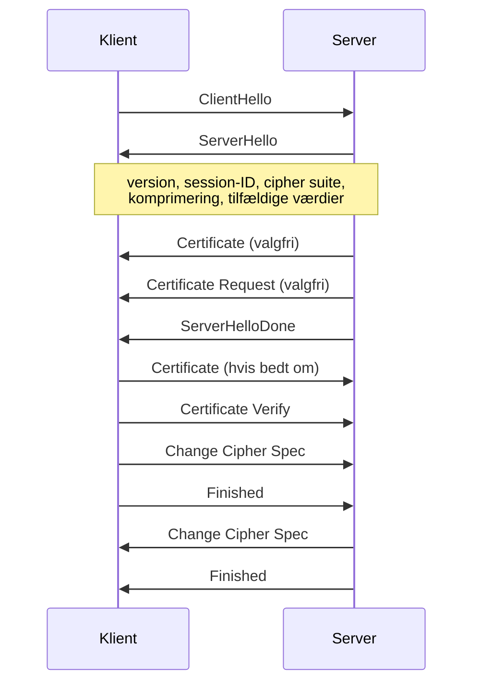

# Sikre protokoller – TLS, IPsec og WiFi

Del af [[Sikkerhed]]. Her samles byggestenene fra [[Kryptografi]], [[Hashing, digitale signaturer og MAC'er]] og [[Certifikater og PKI]] til sikre kanaler. Sikkerhed er bygget ind på **forskellige lag** af [[TCP-IP protocol stack|TCP/IP-stakken]] *(Deitel 19.10)*:

| Protokol | Lag | Sikrer |
|---|---|---|
| **SSL/TLS** | Mellem **transport** og **applikation** | Én point-to-point-forbindelse mellem to applikationer |
| **IPsec** (→ VPN) | **Netværkslaget** | **Al** trafik mellem alle brugere på netværket |
| **WEP / WPA** | **Link-laget** (802.11) | Den trådløse forbindelse |

> **Jo lavere i stakken, jo mere beskyttes automatisk, men jo sværere er det at indføre.** TLS kræver bare et bibliotek i applikationen; IPsec ligger i OS'et eller hardwaren.

---

## TLS (og SSL)

SSL blev udviklet af Netscape og standardiseret af IETF som **TLS** (RFC 2246), konceptuelt næsten identisk. TLS er **de facto-standarden** for sikre kanaler: HTTPS, men også sikker Telnet og FTP *(Coulouris 11.6.3)*.

**Hvorfor er TCP ikke nok?** TCP garanterer, at pakker **kommer frem**, men **ikke** at de er **uændrede** *(Deitel 19.10.1)*, se [[Transport layer]].

### De to designidéer

*(Coulouris 11.6.3)*

| Idé | Hvorfor |
|---|---|
| **Forhandlingsbare algoritmer** | I et åbent netværk har ikke alle samme software, og nogle lande begrænser algoritmer. Algoritmerne aftales i handshaket; har parterne ikke nok til fælles, fejler forbindelsen |
| **Bootstrapped sikker kommunikation** | Uden forudgående aftale og uden tredjepart: start **ukrypteret** → **public-key** → **secret-key** |

Kanalen er **fuldt konfigurerbar**: kryptering og autentificering kan slås til pr. retning.

### Arkitekturen: to lag

```
┌──────────────┬──────────────────┬─────────────┬──────┬────────┐
│ TLS Handshake│ TLS Change       │ TLS Alert   │ HTTP │ Telnet │ …
│ Protocol     │ Cipher Spec      │ Protocol    │      │        │
├──────────────┴──────────────────┴─────────────┴──────┴────────┤
│                     TLS Record Protocol                        │
├────────────────────────────────────────────────────────────────┤
│                 Transport layer (typisk TCP)                   │
└────────────────────────────────────────────────────────────────┘
```

| Lag | Rolle |
|---|---|
| **Record Protocol** | **Implementerer den sikre kanal**: secrecy, integrity og authenticity, præcis det sikkerhedsmodellen i [[Fundamentale modeller]] kræver |
| **Handshake-laget** | Etablerer og vedligeholder en **TLS-session**. Sessions har et ID, der kan caches |

### Handshaket



1. **Hello:** serveren tilbyder **cipher suites**, klienten vælger én. De aftaler også komprimering og en tilfældig startværdi til CBC (IV)
2. **Certifikater:** parterne autentificerer **valgfrit** hinanden med X.509. **Typisk autentificeres kun serveren**; mange butikker anser et gyldigt kreditkortnummer for nok *(Deitel 19.10.1)*
3. **Pre-master secret:** én part sender en stor tilfældig værdi **krypteret med den andens public key**. Begge udleder heraf **to session keys** (én pr. retning) og **MAC-hemmeligheder**
4. **Change Cipher Spec + Finished:** herefter er alt krypteret og MAC'et

**Cipher suite** = et valg af **key exchange-metode** (fx RSA), **cipher** til data (fx IDEA/AES) og **message digest** til MAC (fx SHA-1). Handshaket kan køres igen midt i en session.

### Man-in-the-middle i TLS
Handshaket er sårbart over for MITM. **Forsvar:** den public key, der verificerer det første certifikat, kommer **ad en anden kanal** (browsere leveres med indbyggede CA-nøgler), og serverens **domænenavn står i certifikatet** *(Coulouris 11.6.3)*.

### Record Protocol: pipelinen
```
Application data → Fragment → Compress → MAC → Encrypt → Transmit (TCP)
```
**Hvorfor komprimere før kryptering?** Mindre data at sende, komprimeret data har færre mønstre, og krypteret data kan ikke komprimeres, fordi det ser tilfældigt ud *(Deitel 19.10.1)*. Coulouris tilføjer, at en pipeline i samme lag deler arbejdet med bulk-data effektivt.

### Hvorfor TLS lykkedes
- **Hybrid:** public-key til autentificering og nøgleudveksling, secret-key til data
- **Afhænger ikke af bestemte algoritmer**
- **Kræver ingen sikre services ved oprettelse**, kun certifikater fra en autoritet, begge anerkender
- **Publiceret og reviewet åbent**

**Den blinde vinkel:** TLS beskytter data **under transport**, ikke når de er gemt. Se [[Forsvarsmekanismer|secure file systems]].

---

## VPN og IPsec

*(Deitel 19.10.2)*

**VPN:** sikre kanaler over **offentlig** infrastruktur. Billigere end private WAN'er. Kanalen kaldes en **tunnel**, og **IPsec** (IETF) er den typiske implementering, med både public- og secret-key.

**Problemet:** IP-pakker kan opsnappes, ændres og gensendes uden at det opdages, og **IP spoofing** lader en angriber udgive sig for en anden adresse.

**Tunneling:** IPsec krypterer pakkens **payload** og lægger den **i en ny, ukrypteret IP-pakke**. Den ydre pakke skal være ukrypteret, fordi **routerne skal kunne læse destinationen**. Samme tunnel-princip som IPv6-over-IPv4 og MobileIP ([[Network layer og IP routing]]).

| VPN-krav | IPsec-komponent | Hvad den gør |
|---|---|---|
| **Brugerautentificering** | **AH** (Authentication Header) | Verificerer **afsender** og at data er **uændrede** |
| **Datakryptering** | **ESP** (Encapsulating Security Payload) | Krypterer data med **symmetriske** nøgler |
| **Kontrolleret adgang** | **IKE** (Internet Key Exchange) | Key management, sikker nøgleudveksling |

Typisk Diffie-Hellman eller RSA til nøgleudveksling, DES/3DES til data.

> ⚠️ Deitels ordliste kalder IPsec en "transport-layer"-protokol. Det er forkert: den ligger på **netværkslaget** (står korrekt i selve teksten).

| | TLS | IPsec |
|---|---|---|
| Scope | **Én forbindelse** mellem to applikationer | **Al** trafik på netværket |
| Installeres i | Applikationen | OS/hardware |
| Udbredelse | Nem | Svær at administrere |

---

## WEP og WPA

**Hvorfor er trådløst svært?** Kablet aflytning kræver fysisk adgang; trådløst kan **alle inden for rækkevidde** lytte og udgive sig for andre. Samtidig har trådløse enheder lav båndbredde og lidt regnekraft, så tung kryptering er dyr *(Deitel 19.10.3)*.

### Sådan virker WEP

*(Deitel 19.10.3)*
1. Tilføj en **checksum** til beskeden
2. **RC4** genererer en **keystream** ud fra en **delt secret key** (40/64/128 bit) + en tilfældig **24-bit IV**
3. Ciphertext = plaintext **XOR** keystream
4. Pakken sendes med **IV i klartekst**
5. Modtageren genererer samme keystream og XOR'er igen

Access control sker via challenge-response med **samme ene delte nøgle** for base station og alle enheder.

### Hvorfor WEP fejlede

*(Coulouris 11.6.4)*

> Kapitlets **object lesson**: et system designet med sikkerhed for øje, af en standardiseringsorganisation, fejlede på næsten alle punkter. Hver fejl bryder et princip.

| # | Svaghed | Brudt princip | Løsning |
|---|---|---|---|
| 1 | **Én nøgle deles af alle** og bruges i måneder; én skødesløs bruger kompromitterer hele netværket | *Begræns levetid og omfang af enhver hemmelighed* | **Individuelle nøgler** forhandlet med public-key |
| 2 | **Base stationer autentificeres aldrig**, så en falsk base station kan opsættes | Autentificering skal gå **begge veje** | Base stationer viser et certifikat |
| 3 | **Genbrugt keystream:** 24-bit IV giver kun 2²⁴ ≈ 10⁷ startværdier, og IV sendes i klartekst. Kendes én plaintext, kan alle pakker med samme IV dekrypteres | En stream cipher må **aldrig genbruge keystream** | Ny nøgle før keystreamen gentages |
| 4 | **40/64-bit nøgler** pga. USA's eksportregler | *Angribere har store ressourcer* | Kun 128 bit |
| 5 | **RC4 selv viste sig svag** (2001) | **Hardkodet algoritme** | Forhandlingsbare ciphers |
| 6 | **Brugere slog det ikke til** (leveret med sikkerhed slået fra) | Defaults og dokumentation | Bedre defaults. Skjult SSID og MAC-filtrering hjælper ikke |

Deitel nævner desuden, at den **simple checksum** lader en angriber ændre både besked og checksum.

> **Mønsteret:** næsten hver løsning er "gør det, TLS gør". WEP er en liste over alt det, TLS gør rigtigt.

### Efterfølgerne
**WPA** (2003): bedre kryptering, **brugerautentificering** via en authentication server, og **en unik nøgle pr. klient** *(Deitel 19.10.3)*. Derefter **WPA2 / IEEE 802.11i** (2004), som bruger **AES i stedet for RC4** *(Coulouris 11.6.4)*.
